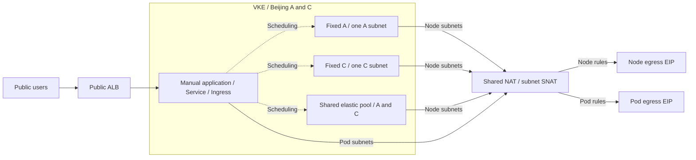

# Enterprise Container Infrastructure and Autoscaling on Volcengine

Create a multi-AZ VKE foundation in your Volcengine account: an isolated VPC, Node/Pod subnets, separate internet egress, fixed and elastic node pools, operational addons, and a public ALB. Beijing A/C each default to one fixed node, with a separate pool for elastic capacity. After deployment, use the bundled Kubernetes examples to configure ALB Ingress and applications, then verify public access, HPA, and node scaling.

[简体中文](README.zh-CN.md)

## 1. Business Background

Container deployments need coordinated networking, egress, compute capacity, load balancing, and operational components. Manual provisioning can miss dependencies or mix environment settings.

- **Baseline and peak capacity differ**: persistent services need stable nodes, while traffic peaks need independently expandable capacity.
- **Network boundaries need clarity**: Node and Pod networks use separate subnets and public EIPs.
- **Multi-AZ needs actual coverage**: listing multiple subnets does not prove that nodes are distributed across zones.
- **Pod and node scaling must cooperate**: HPA adjusts replicas using metrics; cluster-autoscaler adds nodes for unschedulable Pods.

This solution manages the infrastructure through Terraform while keeping application management separate.

## 2. Solution Overview

- **Network**: creates a VPC and one Node and one Pod subnet per AZ, using `VpcCniShared`. One public NAT applies SNAT by source subnet.
- **Egress**: two traffic-billed EIPs, dedicated to Nodes and Pods, with corresponding SNAT rules in each AZ.
- **Compute**: one non-autoscaling fixed pool per AZ, bound only to that AZ's Node subnet; one shared elastic pool defaults to initial 1, minimum 0, maximum 10.
- **Components**: installs Prometheus, logging, NPD, and optional autoscaler; reads platform ALB controller, CCM, and VPC-CNI; reconciles CoreDNS and metrics-server during Apply.
- **Ingress**: Terraform creates the public ALB. Users configure ALBInstance, Service, and Ingress; the Ingress controller owns listeners and backends.



Solid diagram edges show request/network paths; dotted edges show Pod scheduling. Applications, Services, and Ingress are user-deployed cluster objects, not Terraform-created cloud resources.

After infrastructure creation, obtain a kubeconfig, bind an ALBInstance, deploy the example application, and access it publicly. CPU metrics drive HPA; capacity-related Pending Pods drive elastic node expansion. Fixed pools provide baseline capacity independently of automatic scale-down.

The bundled `terraform_data + local-exec + Python` reconciler creates CoreDNS and metrics-server, then reads their status. Existing matching versions and deployment modes are retained. It does not automatically upgrade or independently delete them; cluster deletion reclaims them. The template does not install scheduler-plugin; ordinary workloads use the default Kubernetes scheduler.

## 3. IaC Design

### 3.1 Resource Inventory

With two AZs and autoscaler management enabled, the default creates **21 cloud resources and one Terraform helper, for 22 additions**.

| Terraform resource | Count | Purpose |
|---|---:|---|
| `volcenginecc_vpc_vpc` | 1 | Isolated VPC |
| `volcenginecc_vpc_subnet` | 4 | One Node and Pod subnet in each of A/C |
| `volcenginecc_natgateway_ngw` | 1 | Shared public NAT in the first Node subnet |
| `volcenginecc_vpc_eip` | 2 | Separate Node and Pod egress |
| `volcenginecc_natgateway_snatentry` | 4 | Per-AZ subnet associations with the correct EIP |
| `volcenginecc_vke_cluster` | 1 | Managed VKE cluster |
| `volcenginecc_vke_node_pool` | 3 | Two single-AZ fixed pools and one shared elastic pool |
| `volcenginecc_vke_addon` | 4 | Prometheus, logging, NPD, autoscaler |
| `volcenginecc_alb_load_balancer` | 1 | Public application entry |
| `terraform_data` | 1 | Reconcile cluster-owned CoreDNS and metrics-server |

Five Data Sources only read three platform components and two reconciled components. Worker ECS instances, disks, NICs, implicit security groups, ALB embedded public EIPs, the control plane, and in-cluster components are not counted again as the 21 resources, but still require quota, billing, and cleanup checks.

Disabling `manage_cluster_autoscaler` gives 20 cloud resources plus one helper. Three AZs add two subnets, two SNATs, and one fixed pool: 26 cloud resources plus one helper. Callers provide existing SSH keys, State storage, and operational access. The template does not create IAM roles or monitoring/logging backends.

### 3.2 Project Structure

```text
.
├── main.tf / locals.tf / variables.tf / outputs.tf
├── providers.tf / versions.tf / terraform.tfvars
├── preflight.tf / PREFLIGHT.md
├── .gitignore
├── modules/
│   ├── network/
│   ├── cluster/
│   ├── nodepools/
│   ├── addons/
│   └── alb/
├── scripts/
│   ├── preflight.py
│   ├── apply-checked.py
│   ├── reconcile-required-addons.py
│   ├── bootstrap-dns.py
│   └── prepare-destroy.py
├── examples/
│   ├── app.yaml
│   ├── hpa.yaml
│   └── node-scale-test.yaml
└── README.md / README.zh-CN.md
```

Each module contains `main.tf`, `variables.tf`, `outputs.tf`, and `versions.tf`. The root configures the Provider; outputs establish network, cluster, pool, and addon dependencies. Resource tags come exclusively from `tags`, which defaults to `{}`. The template adds no Name, Environment, Project, Owner, or CostCenter tags. `project_name` remains the actual cloud project assignment.

### 3.3 Core Code Example

The root `main.tf` passes the network module's per-AZ subnet map and fixed capacity into the node-pool module:

```hcl
module "nodepools" {
  source                   = "./modules/nodepools"
  cluster_id               = module.cluster.id
  name_prefix              = var.name_prefix
  project_name             = var.project_name
  node_subnet_ids_by_zone   = module.network.node_subnet_ids_by_zone
  fixed_replicas_by_zone    = var.fixed_replicas_by_zone
  instance_types           = var.instance_types
  image_id                 = var.image_id
  ssh_key_pair_name         = var.ssh_key_pair_name
  system_volume_size       = var.system_volume_size
  system_volume_type       = var.system_volume_type
  elastic_initial_replicas = var.elastic_initial_replicas
  elastic_min_replicas     = var.elastic_min_replicas
  elastic_max_replicas     = var.elastic_max_replicas
  tags                     = local.common_tags
}
```

Within the module, fixed pools use AZ names from `fixed_replicas_by_zone` as `for_each` keys and each bind one corresponding Node subnet. AZ keys are known at Plan time and do not depend on uncreated subnet IDs. Fixed-count keys must exactly match the selected subnet AZs, with at least one node per AZ. The shared elastic pool uses all Node subnets and `ZoneBalance`. Only external changes to `auto_scaling.desired_replicas` are ignored; Terraform still owns the minimum and maximum.

Fresh creation follows network → cluster → fixed/elastic pools → deletable addons → Required addon reconciliation and readback. ALB is a separate network branch. The cluster owns CoreDNS and metrics-server; Terraform manages deletable addons. Existing pool migration and teardown are described in Sections 4.2.4 and 4.2.5.

## 4. Usage

Deploy and manage the resource stack through InfraManager, or download the complete template and run Terraform locally. Cloud deployment is recommended: select a template and fill in parameters without maintaining your own Terraform runtime. Both entry points use the same parameters and cloud permissions; platform executor requirements are in Section 4.1.1.

Terraform creates infrastructure and components; Kubernetes operations configure and validate applications, Ingress, and HPA.

### 4.1 Cloud Deployment

InfraManager is Volcengine's Terraform hosting workbench. See the [product introduction](https://docs.volcengine.com/docs/infrastructure-management/product-introduction?lang=zh).

#### 4.1.1 Permissions and Prerequisites

Enable VKE, ECS, VPC, NAT, EIP, and ALB in the target account. Check the project, balance, regional instance stock, disks, ENIs, Pod IP space, and node quotas. On first use, follow service-console instructions for VKE, ALB, and NAT service-linked roles, including `ServiceRoleForNatGateway`.

The execution identity needs CloudControl and resource create/read/update/delete, tag, and association permissions. The reconciler also calls VKE `ListClusters`, `ListSupportedAddons`, `ListAddons`, and `CreateAddon`. Provide an existing regional ECS SSH key-pair name, not its private key.

**The platform executor needs `/bin/sh`, Python 3, VKE/ECS HTTPS access, and deployment credentials inherited by child processes.** The `hashicorp/external ~> 2.3` Provider runs availability preflight during Plan; see [PREFLIGHT.md](PREFLIGHT.md) for read permissions and regional version confirmation. Reconciliation runs in the Terraform Apply environment. Temporary identities also require `VOLCENGINE_SESSION_TOKEN`. The platform deployment identity provides credentials; do not store them in template variable files.

The Kubernetes API is private by default. Later kubectl operations need VPN or a same-VPC operational host. Workers and Pods need access to image registries; the examples use public ECR images, whose availability must be checked from the target network.

#### 4.1.2 Select the Template

Open the [InfraManager console](https://console.volcengine.com/iac) and enter **Template management > Public templates**. After publication, search for “企业级容器集群自动化管理和弹性扩缩容”.

The platform must publish the template before it becomes searchable. For the local revision, import a complete custom template and create a stack from it.

Preserve relative paths for root Terraform files, `modules/`, `scripts/`, and `examples/`. Uploading only `.tf` files omits the Apply-time reconciler. The release excludes internal `docs/` records, `.terraform.lock.hcl`, `.env`, State, Plan, caches, kubeconfig, and local deployment outputs. ZIP entries must use `/` separators.

#### 4.1.3 Create the Stack

Select the template, click **Create stack**, and fill in stack information and parameters from Section 4.2.1. Supply the required existing regional `ssh_key_pair_name` and a unique `name_prefix`. Verify that `zones`, both subnet types, and `fixed_replicas_by_zone` agree on AZs.

Keep VKE deletion protection enabled and ALB protection disabled by default, using platform stack protection. Generate the execution plan and inspect actual inputs and all additions, updates, deletions, and replacements. A fresh default environment has 22 additions; deploy after review.

Inspect deployment events for reconciliation logs and confirm that CoreDNS and metrics-server are retained or created and reach Running/Ok. Continue with validation after Apply; static outputs and successful resource creation do not prove application readiness.

#### 4.1.4 Deployment Validation

Confirm deployment status is successful on the stack details page, then use template outputs to identify the environment:

| Output | Purpose |
|---|---|
| `vpc_id`, `subnets`, `nat_gateway_id` | VPC, per-AZ Node/Pod subnets, and NAT |
| `egress` | Node/Pod EIP addresses and per-AZ SNAT identifiers |
| `cluster_id`, `cluster_status` | Cluster identity and service status |
| `api_server_endpoints` | API addresses, without kubeconfig |
| `nodepools` | Fixed pools indexed by AZ and shared elastic pool ID/status |
| `addons` | Deletable, platform, and reconciled component status |
| `alb_id`, `alb_dns_name` | ALB identity and public hostname |
| `alb_instance_manifest` | ALB binding manifest for the Ingress controller |

Check console relationships and status: each fixed pool has one local Node subnet, Node/Pod SNATs use their designated EIPs, and all four specified addons are Running/Ok. Platform ALB controller, CCM, VPC-CNI and reconciler-managed CoreDNS/metrics-server should also be healthy. A Provider pool identifier may use `cluster_id|node_pool_id`; use its pool ID portion in the VKE console.

Obtain a short-lived kubeconfig from the VKE console, store it in a controlled directory, and run from an environment that can reach the private API:

```bash
export KUBECONFIG="/secure/path/to/kubeconfig"
kubectl get nodes -L workload-pool,topology.kubernetes.io/zone
kubectl -n kube-system get pods
kubectl -n kube-system get service kube-dns
kubectl -n kube-system get endpoints kube-dns
kubectl get --raw /apis/metrics.k8s.io/v1beta1/nodes
```

The default should have one fixed Ready node in each of A/C and one initial elastic node. Cross-check actual `ZoneId` and primary NIC subnet in VKE and ECS details; configuration and node labels alone are insufficient.

**Configure public application ingress.** Save `alb_instance_manifest` to a temporary YAML file on the operational host:

```bash
kubectl apply --dry-run=server -f /tmp/vke-alb-instance.yaml
kubectl apply -f /tmp/vke-alb-instance.yaml
kubectl apply -f examples/app.yaml
kubectl -n vke-demo rollout status deployment/web --timeout=300s
kubectl -n vke-demo get ingress,service,pods -o wide
kubectl -n vke-demo exec deployment/web -- nslookup kubernetes.default.svc.cluster.local
```

From outside the cluster, access `http://<alb_dns_name>/` and expect HTTP 200 with the Nginx page. Check the HTTP 80 listener, backend group, Ready Pod IPs, and Service Endpoints. The Pod example uses `ScheduleAnyway` for AZ spreading; inspect actual placement rather than assuming strict disaster recovery.

**Verify both egress paths.** Fill in the two addresses from `egress` and adjust the loop to your actual `zones`. Each AZ gets ordinary and hostNetwork Pods on its fixed node. The hostNetwork test shares the node network; the ordinary test uses the Pod network.

```bash
(
set -euo pipefail
NODE_EGRESS_IP="<egress.node.address>"
POD_EGRESS_IP="<egress.pod.address>"
for zone in cn-beijing-a cn-beijing-c; do
  for role in node pod; do
    host_network=false
    dns_policy=ClusterFirst
    expected="$POD_EGRESS_IP"
    if [ "$role" = node ]; then
      host_network=true
      dns_policy=ClusterFirstWithHostNet
      expected="$NODE_EGRESS_IP"
    fi
    probe=$(cat <<EOF | kubectl create -f - -o name
apiVersion: v1
kind: Pod
metadata:
  generateName: egress-${role}-${zone##*-}-
  namespace: vke-demo
spec:
  restartPolicy: Never
  hostNetwork: ${host_network}
  dnsPolicy: ${dns_policy}
  nodeSelector:
    workload-pool: fixed
    topology.kubernetes.io/zone: ${zone}
  containers:
    - name: check
      image: public.ecr.aws/docker/library/nginx:1.28-alpine
      command: ["curl", "-fsS", "--connect-timeout", "5", "--max-time", "30", "https://checkip.amazonaws.com"]
EOF
)
    kubectl -n vke-demo wait --for=jsonpath='{.status.phase}'=Succeeded "$probe" --timeout=180s
    observed=$(kubectl -n vke-demo logs "$probe" | tr -d '\r\n')
    printf '%s %s observed=%s expected=%s\n' "$zone" "$role" "$observed" "$expected"
    test "$observed" = "$expected"
    kubectl -n vke-demo get "$probe" -o wide
    kubectl -n vke-demo delete "$probe" --wait=true
  done
done
)
```

Ordinary Pods must return the Pod EIP and hostNetwork Pods the Node EIP; all four paths must match. Also check `hostIP/podIP`, local Node/Pod CIDRs, and exact subnet/EIP SNAT members. On failure, retain the probe for describe/log inspection and remove it afterwards. Inspect DNS, TLS, and the destination before attributing an unreachable echo service to SNAT.

**Verify elastic nodes and HPA.** Use the bundled example test namespace:

```bash
kubectl -n vke-demo apply -f examples/node-scale-test.yaml
kubectl -n vke-demo scale deployment/node-scale-test --replicas=40
kubectl -n vke-demo get pods -l app=node-scale-test -o wide
kubectl get nodes -L workload-pool,topology.kubernetes.io/zone
kubectl -n vke-demo delete deployment/node-scale-test --wait=true
kubectl apply -f examples/hpa.yaml
kubectl -n vke-demo get hpa web
kubectl -n vke-demo top pods -l app=web
```

Each node-scaling test Pod requests one CPU and can only use the elastic pool. Adjust replicas to exceed allocatable capacity, verify Pending due to insufficient CPU, new Ready nodes and Ready Pods, while each fixed pool retains its count. After removing load, observe node reduction. Default idle and post-expansion delays are both 10 minutes; PDBs, system Pods, and local storage may prevent further shrinking.

HPA uses a 60% CPU target, 2–30 replicas, and a 300-second scale-down stabilization window. In an independent test environment, create five load Pods with up to twenty concurrent request loops each:

```bash
kubectl -n vke-demo create deployment hpa-load \
  --image=public.ecr.aws/docker/library/busybox:1.37 --replicas=5 \
  -- sh -c 'for n in $(seq 1 20); do while true; do wget -q -T 2 -O- http://web/ >/dev/null || true; done & done; wait'
kubectl -n vke-demo rollout status deployment/hpa-load --timeout=180s
kubectl -n vke-demo get hpa web -w
# Stop watching with Ctrl+C, then remove load:
kubectl -n vke-demo delete deployment/hpa-load --ignore-not-found --wait=true
kubectl -n vke-demo get deployment web
```

Record CPU metrics and increased Ready replicas, stop load, then verify actual/Ready replicas return to two. Bound load by quota and cost. Small Nginx loads may not exceed the threshold; installing Prometheus does not replace metrics API validation.

### 4.2 Local Deployment

Download the complete template and run Terraform from its root. The same private Kubernetes connectivity requirements apply after deployment.

#### 4.2.1 Environment Preparation

**Runtime**: Terraform `>= 1.5.7, < 2.0.0`, Python 3, and `/bin/sh`. The Provider constraint is `volcengine/volcenginecc ~> 0.0.74`, meaning `>= 0.0.74, < 0.1.0`. The release does not bundle `.terraform.lock.hcl`. The first `terraform init` selects a compatible version and generates a lock file in the deployment directory; retain that environment's lock file to fix subsequent selections. Existing local configuration checks used 0.0.74; other versions need separate validation.

**Credentials**:

```bash
export VOLCENGINE_ACCESS_KEY="<access-key>"
export VOLCENGINE_SECRET_KEY="<secret-key>"
export TF_VAR_ssh_key_pair_name="<existing-regional-key-pair>"
# Temporary credentials also require VOLCENGINE_SESSION_TOKEN.
```

Pass AK/SK and Session Token through the environment, not HCL or `tfvars`. The SSH variable is a name only; the template does not generate passwords or kubeconfig. The Provider uses `var.region`; `VOLCENGINE_REGION` alone does not override file settings. Same-name assignments in `terraform.tfvars` take precedence over `TF_VAR_*`.

**Key parameters**: defaults below come from `variables.tf`; `terraform.tfvars` additionally supplies addon version examples. Recheck all regions, specifications, and versions before deployment.

| Parameter | Default / input | Description |
|---|---|---|
| `region` / `project_name` | `cn-beijing` / `default` | Region and existing project |
| `name_prefix` | `vke` | 2–36 characters; lowercase letter first, then letters/digits/hyphens |
| `tags` | `{}` | Only explicitly supplied user tags are attached |
| `tags` | `{}` | Extra tags; base fields take precedence |
| `vpc_cidr` | `10.0.0.0/16` | New private VPC |
| `zones` | Beijing A/C, two subnet types each | 2–3 distinct AZs; Node/Pod CIDRs inside the VPC, without overlap |
| `service_cidr` | `172.22.0.0/22` | Must not overlap the VPC or connected networks |
| `kubernetes_version` | `1.32` | `1.xx` format; check supported releases |
| `kubernetes_version_confirmation` | `null` | Required creation evidence for this region and full Kubernetes version, valid for 24 hours; see [preflight](PREFLIGHT.md) |
| `instance_types` | `["ecs.g4il.4xlarge"]` | 1–10 distinct VKE-compatible types; preflight checks current stock in every AZ |
| `image_id` | `null` | VKE default for one type; multiple types need a common compatible image |
| `ssh_key_pair_name` | Required | Existing regional key-pair name |
| `system_volume_size` / `system_volume_type` | `80` / `ESSD_PL0` | GiB, integer 40–2048; also supports `ESSD_FlexPL` |
| `fixed_replicas_by_zone` | A=1, C=1 | Keys exactly match `zones`; integer 1–2000 per AZ |
| `elastic_initial_replicas` / `elastic_min_replicas` / `elastic_max_replicas` | `1` / `0` / `10` | Integers with `0 <= min <= initial <= max <= 2000` |
| `nat_spec` | `Small` | Also Medium, Large, Extra_Large_1/2; check regional availability |
| `egress_bandwidth` | `10` | Mbps cap for each outbound EIP, integer 1–200 |
| `alb_bandwidth` | `10` | Create-time inbound EIP cap, integer 1–200 Mbps; changes may replace ALB |
| `vke_delete_protection_enabled` | `true` | Disable through a reviewed update before deletion |
| `alb_delete_protection_enabled` | `false` | Use platform stack protection; existing protected ALBs need migration guidance |
| `api_server_public_access_enabled` | `false` | Private API by default; arrange management controls if exposing it |
| `addon_versions` | `{}`; file provides four versions | Prometheus, logging, NPD, autoscaler map; explicit versions recommended |
| `required_addons` | CoreDNS 1.12.4, metrics-server v0.7.1-vke.6 | Both default to Unmanaged/Node; only these two are accepted |
| `required_addons_reconcile_nonce` | `run-1` | Change after repairing external drift to rerun reconciliation |
| `required_addons_timeout_seconds` | `1200` | Overall reconciliation limit, integer 300–3600 seconds |
| `manage_cluster_autoscaler` | `true` | Template management switch; disabling it requires an existing scaling controller |
| `scale_down_unneeded_minutes` | `10` | Idle scale-down wait, integer 1–60 minutes |

Size Node/Pod subnets for address capacity. Callers must check overlap with connected external networks. Resolve ownership of already installed addons rather than recreating them. Existing autoscaler can be imported during a controlled migration, or left externally managed with its configuration verified.

#### 4.2.2 Deployment Scenarios

**Scenario one: default two-AZ foundation.** Check that Beijing A/C, instance types, addon versions, and SSH key input in `terraform.tfvars` suit the account, then prepare an independent environment as follows.

Set these base values in your variable file, replacing `vke-demo` with a unique environment prefix and retaining the other verified settings:

```hcl
region      = "cn-beijing"
name_prefix = "vke-demo"
zones = [
  { zone_id = "cn-beijing-a", node_cidr = "10.0.0.0/24", pod_cidr = "10.0.16.0/20" },
  { zone_id = "cn-beijing-c", node_cidr = "10.0.1.0/24", pod_cidr = "10.0.32.0/20" },
]
fixed_replicas_by_zone = {
  cn-beijing-a = 1
  cn-beijing-c = 1
}
elastic_initial_replicas = 1
elastic_min_replicas     = 0
elastic_max_replicas     = 10
# Supply ssh_key_pair_name through platform parameters or TF_VAR_ssh_key_pair_name.
```

Initialize and plan with automatic preflight, then apply the reviewed plan with a fresh inventory check. First supply the regional version confirmation described in [PREFLIGHT.md](PREFLIGHT.md).

```bash
terraform init
terraform fmt -check -recursive
terraform validate
terraform plan -out=deploy.tfplan
terraform show deploy.tfplan
# Apply after reviewing the plan:
python3 scripts/apply-checked.py deploy.tfplan
```

Terraform preflight receives resolved inputs and checks per-AZ VKE support, live ECS inventory, selected addon versions and image compatibility. FAIL or UNKNOWN blocks the plan before cloud creation. Regional Kubernetes creation support requires explicit confirmation because no verified public query is available; addon compatibility alone cannot prove it. Platform addons are checked for compatible candidates; their installed versions remain service-managed. Stock is a snapshot, not a capacity reservation. The checked apply command rechecks the saved plan's inputs before applying. A fresh plan still has 22 managed additions. Apply reconciles the two components; a separate `bootstrap-dns.py` run is not required.

**Scenario two: fixed baseline only.** In another independent test environment with empty State, keep scenario one's network and per-AZ fixed counts. Replace only the prefix and initial elastic capacity:

```hcl
name_prefix             = "vke-baseline-demo"
elastic_initial_replicas = 0
elastic_min_replicas     = 0
elastic_max_replicas     = 10
```

Use a unique prefix and the same init/plan/show/apply workflow as scenario one. The plan still has 22 additions, but only the two fixed workers start initially. Verify both zones, DNS, and egress. This scenario tests the initial fixed baseline; the enabled autoscaler can still add elastic nodes under later load.

Both scenarios create independent new environments. Existing elastic pools ignore live desired-count changes: editing `elastic_initial_replicas` does not reset running capacity to zero or replace a scale-down operation or migration.

For three AZs, add a `zones` entry with separate Node/Pod CIDRs and a matching `fixed_replicas_by_zone` entry, with at least one node per zone. Autoscaler-managed plans have 27 additions. Confirm the third AZ's services and instance types first.

#### 4.2.3 Expected Deployment Results

```bash
terraform output
terraform output -raw cluster_id
terraform output -json nodepools
terraform output -json egress
terraform output -raw alb_instance_manifest > /tmp/vke-alb-instance.yaml
```

The default has three pools; fixed outputs are indexed by AZ, such as `nodepools.fixed["cn-beijing-a"].id`. Both initial-capacity scenarios have 21 cloud resources plus one helper. Disabling template autoscaler management removes one cloud resource. Creating the ALB does not create an application or prove listener readiness; Section 4.1.4 explains other outputs and expected status.

Workers, system disks, the VKE control plane, NAT, EIPs, ALB, and public traffic have corresponding charges. Running elastic nodes are also billable. Resource counts do not equal billing-item counts; cost depends on specifications, duration, and usage. Protect State, Plan, and output identities; do not commit credentials or runtime artifacts.

#### 4.2.4 Post-deployment Validation and Updates

Use local outputs for resource identities and the ALBInstance manifest, then perform Section 4.1.4's console checks, private kubectl, DNS, public ingress, four egress paths, and scaling tests.

At each stable point, run two consecutive plans:

```bash
for n in 1 2; do
  rc=0
  terraform plan -input=false -detailed-exitcode || rc=$?
  printf 'plan-%s exit=%s\n' "$n" "$rc"
  if [ "$rc" -ne 0 ]; then break; fi
done
```

Both must return 0. Exit 2 means planned changes; 1 means an error. Inspect the cause first. Use the same environment and latest inputs after parameter changes.

In a test environment, change `egress_bandwidth` from 10 to 11, verify only two outbound EIPs update in place, apply, and independently read the same IDs and actual bandwidth. Run two plans, then roll back to 10 and repeat. Cloud users update stack parameters; local users edit their controlled variable file and generate a fresh plan.

Fixed pools changed from a singleton to per-AZ instances. Replace old `fixed_replicas` with the map and update `.fixed.id` consumers. Existing pools need a staged migration: create new pools, confirm Ready, drain workloads, then remove old pools. Changing the nonce can reconcile missing matching components; it does not implement automatic upgrades.

#### 4.2.5 Destroy Resources

Back up needed application data and remove user-created applications, Ingress, and ALBInstance, allowing the controller to reclaim listeners, backend groups, and rules. These Kubernetes commands are only for the bundled test environment:

```bash
kubectl delete -f examples/hpa.yaml --ignore-not-found
kubectl -n vke-demo delete -f examples/node-scale-test.yaml --ignore-not-found
kubectl delete -f examples/app.yaml --ignore-not-found
kubectl delete albinstance vke-alb --ignore-not-found
```

`app.yaml` includes the test namespace. If it contains other workloads, remove only the objects created for this test. Confirm controller cleanup and Terraform ownership of the ALB before deleting infrastructure.

For fresh environments created with ALB protection false:

```bash
terraform plan -var='vke_delete_protection_enabled=false' -out=exit.tfplan
terraform show exit.tfplan
# Continue only with expected in-place updates and no unexpected replacements:
terraform apply exit.tfplan
terraform plan -destroy -var='vke_delete_protection_enabled=false'
terraform destroy -var='vke_delete_protection_enabled=false'
```

Keep the region, Workspace, State, and other inputs unchanged. InfraManager users first update VKE protection to false, then disable stack deletion protection and delete cloud resources; no local State download is required.

For existing ALBs with cloud protection true, retain the original inputs rather than applying the new defaults. Locally, inspect with `python3 scripts/prepare-destroy.py --region cn-beijing`, substituting the actual region. Confirm ownership and the proposed protection changes, then add `--apply`. The script disables protection on the same resource IDs; proceed directly to Destroy without an intervening ordinary Apply. Cloud users can confirm protection is disabled in the relevant service consoles before deleting the target stack. Stop at unexpected replacement plans. On failure, retain State and inspect cloud tasks and remnants rather than removing State first.

CoreDNS, metrics-server, and platform components are reclaimed with the cluster, without independent DeleteAddon calls. Afterwards, check IDs and this environment's VPC for cluster, pools, workers, subnets, NAT, SNAT, four EIPs (two outbound and two inbound), and ALB subresources. Existing SSH keys and the State backend are outside deletion scope; separately revoke short-lived kubeconfig and remove temporary test files.

## 5. Summary

The template provides per-AZ fixed baseline pools, independent elastic capacity, Node/Pod egress separation, and public ALB ingress, with operational addon installation and readback. It delivers container infrastructure; applications, Ingress, HPA, logging integration, and application data remain user-managed. NPD detects node problems rather than implementing automatic repair.

The per-AZ fixed-pool revision passed Terraform 1.5.7 formatting, configuration, and ten local plan scenarios. **The new layout has not completed cloud lifecycle acceptance.** Earlier single-pool tests cannot certify it. Full InfraManager lifecycle, delegated identity, and State isolation also need target-environment validation.

One shared NAT resides in the first Node subnet and does not provide cross-AZ NAT failover. The example entry uses HTTP, and application replica placement must be inspected. Production needs appropriate TLS, backups, capacity planning, network policies, and monitoring. Installed Prometheus/logging agents do not prove ingestion into VMP/TLS; those backends are not created here.

Regional service specifications, versions, billing, and permissions are governed by the target console and official documentation. This README retains component ownership, migration, and teardown instructions; internal remediation and acceptance records are excluded from the release.
