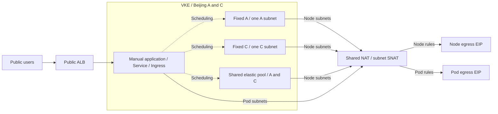

# Enterprise Container Infrastructure and Autoscaling on Volcengine

Create a multi-AZ VKE foundation in your Volcengine account: an isolated VPC, Node/Pod subnets, separate internet egress, fixed and elastic node pools, operational addons, and a public ALB. The current example configures one fixed node in each of Beijing A/C, with a separate pool for elastic capacity. After deployment, use the bundled Kubernetes examples to configure ALB Ingress and applications, then verify public access, HPA, and node scaling.

## 1. Business Background

Container deployments need coordinated networking, egress, compute capacity, load balancing, and operational components. Manual provisioning can miss dependencies or mix environment settings.

- **Baseline and peak capacity differ**: persistent services need stable nodes, while traffic peaks need independently expandable capacity.
- **Network boundaries need clarity**: Node and Pod networks use separate subnets and public EIPs.
- **Multi-AZ needs actual coverage**: listing multiple subnets does not prove that nodes are distributed across zones.
- **Pod and node scaling must cooperate**: HPA adjusts replicas using metrics; cluster-autoscaler adds nodes for unschedulable Pods.

This solution manages the infrastructure through Terraform while keeping application management separate.

## 2. Solution Overview

- **Network**: creates a VPC and one Node and one Pod subnet per AZ, using `VpcCniShared`. One public NAT applies SNAT by source subnet.
- **Egress**: two traffic-billed EIPs, dedicated to Nodes and Pods, with corresponding SNAT rules in each AZ.
- **Compute**: one non-autoscaling fixed pool per AZ, bound only to that AZ's Node subnet; one shared elastic pool defaults to initial 1, minimum 0, maximum 10.
- **Components**: installs Prometheus, logging, NPD, and optional autoscaler; reads platform ALB controller, CCM, and VPC-CNI; reconciles CoreDNS and metrics-server during Apply.
- **Ingress**: Terraform creates the public ALB. Users configure ALBInstance, Service, and Ingress; the Ingress controller owns listeners and backends.



The diagram illustrates the current Beijing A/C example. Solid edges show request/network paths; dotted edges show Pod scheduling. Applications, Services, and Ingress are user-deployed cluster objects, not Terraform-created cloud resources.

After infrastructure creation, obtain a kubeconfig, bind an ALBInstance, deploy the example application, and access it publicly. CPU metrics drive HPA; capacity-related Pending Pods drive elastic node expansion. Fixed pools provide baseline capacity independently of automatic scale-down.

The bundled `terraform_data + local-exec + Python` reconciler creates CoreDNS and metrics-server, then reads their status. Existing matching versions and deployment modes are retained. It does not automatically upgrade or independently delete them; cluster deletion reclaims them. The template does not install scheduler-plugin; ordinary workloads use the default Kubernetes scheduler.

## 3. IaC Design

### 3.1 Resource Inventory

Using the current two-AZ `terraform.tfvars` example with template autoscaler management enabled creates **21 cloud resources and one Terraform helper, for 22 additions**. AZs, fixed capacity, and addon versions are required inputs, not variable defaults.

| Terraform Resource | Count | Purpose |
|---|---:|---|
| `volcenginecc_vpc_vpc` | 1 | Isolated VPC |
| `volcenginecc_vpc_subnet` | 4 | One Node and Pod subnet in each of A/C |
| `volcenginecc_natgateway_ngw` | 1 | Shared public NAT in the first Node subnet |
| `volcenginecc_vpc_eip` | 2 | Separate Node and Pod egress |
| `volcenginecc_natgateway_snatentry` | 4 | Per-AZ subnet associations with the correct EIP |
| `volcenginecc_vke_cluster` | 1 | Managed VKE cluster |
| `volcenginecc_vke_node_pool` | 3 | Two single-AZ fixed pools and one shared elastic pool |
| `volcenginecc_vke_addon` | 4 | Prometheus, logging, NPD, autoscaler |
| `volcenginecc_alb_load_balancer` | 1 | Public application entry |
| `terraform_data` | 1 | Reconcile cluster-owned CoreDNS and metrics-server |

The addon module's five Data Sources read three platform components and two reconciled components; the root has one additional `external` Data Source for read-only preflight. None count as created resources. Worker ECS instances, disks, NICs, implicit security groups, ALB embedded public EIPs, the control plane, and in-cluster components are not counted again as the 21 resources, but still require quota, billing, and cleanup checks.

Disabling `manage_cluster_autoscaler` gives 20 cloud resources plus one helper. Three AZs add two subnets, two SNATs, and one fixed pool: 26 cloud resources plus one helper. Callers provide node login credentials, State storage, and operational access. The template does not create IAM roles or monitoring/logging backends.

### 3.2 Project Structure

```text
.
├── modules/
│   ├── network/
│   │   ├── main.tf
│   │   ├── variables.tf
│   │   ├── outputs.tf
│   │   └── versions.tf
│   ├── cluster/
│   │   ├── main.tf
│   │   ├── variables.tf
│   │   ├── outputs.tf
│   │   └── versions.tf
│   ├── nodepools/
│   │   ├── main.tf
│   │   ├── variables.tf
│   │   ├── outputs.tf
│   │   └── versions.tf
│   ├── addons/
│   │   ├── main.tf
│   │   ├── variables.tf
│   │   ├── outputs.tf
│   │   └── versions.tf
│   └── alb/
│       ├── main.tf
│       ├── variables.tf
│       ├── outputs.tf
│       └── versions.tf
├── main.tf
├── locals.tf
├── variables.tf
├── outputs.tf
├── providers.tf
├── versions.tf
├── preflight.tf
├── terraform.tfvars
├── PREFLIGHT.md
├── scripts/
│   ├── preflight.py
│   ├── apply-checked.py
│   ├── reconcile-required-addons.py
│   ├── bootstrap-dns.py
│   ├── prepare-destroy.py
│   └── 验证公网出口.py
├── examples/
│   ├── app.yaml
│   ├── hpa.yaml
│   └── node-scale-test.yaml
├── .gitignore
├── LICENSE
├── README.md
└── README.zh-CN.md
```

The tree lists template deliverables and excludes local editor configuration and internal acceptance records. Each module contains `main.tf`, `variables.tf`, `outputs.tf`, and `versions.tf`. The root configures the Provider; outputs establish network, cluster, pool, and addon dependencies. Resource tags come exclusively from `tags`, which defaults to `{}`. The template adds no Name, Environment, Project, Owner, or CostCenter tags. `project_name` remains the actual cloud project assignment.

### 3.3 Key Code Examples

The root `main.tf` passes the network module's per-AZ subnet map and fixed capacity into the node-pool module:

```hcl
module "nodepools" {
  source                   = "./modules/nodepools"
  cluster_id               = module.cluster.id
  name_prefix              = var.name_prefix
  project_name             = var.project_name
  node_subnet_ids_by_zone   = module.network.node_subnet_ids_by_zone
  fixed_replicas_by_zone    = var.fixed_replicas_by_zone
  instance_types           = var.instance_types
  image_id                 = var.image_id
  node_login_method        = var.node_login_method
  ssh_key_pair_name         = var.ssh_key_pair_name
  node_password            = var.node_password
  system_volume_size       = var.system_volume_size
  system_volume_type       = var.system_volume_type
  elastic_initial_replicas = var.elastic_initial_replicas
  elastic_min_replicas     = var.elastic_min_replicas
  elastic_max_replicas     = var.elastic_max_replicas
  tags                     = local.common_tags
}
```

Within the module, fixed pools use AZ names from `fixed_replicas_by_zone` as `for_each` keys and each bind one corresponding Node subnet. AZ keys are known at Plan time and do not depend on uncreated subnet IDs. Fixed-count keys must exactly match the selected subnet AZs, with at least one node per AZ. The shared elastic pool uses all Node subnets and `ZoneBalance`. Only external changes to `auto_scaling.desired_replicas` are ignored; Terraform still owns the minimum and maximum.

Fresh creation follows network → cluster → fixed/elastic pools → deletable addons → Required addon reconciliation and readback. ALB is a separate network branch. The cluster owns CoreDNS and metrics-server; Terraform manages deletable addons. Existing pool migration and teardown are described in Sections 4.2.4 and 4.2.5.

## 4. Usage

This project supports cloud deployment through InfraManager or local deployment using the downloaded template. Cloud deployment is recommended: you do not need to prepare a Terraform runtime, and you can create and manage resources by entering parameters in the platform.

Terraform creates infrastructure and components; Kubernetes operations configure and validate applications, Ingress, and HPA.

### 4.1 Cloud Deployment

InfraManager is Volcengine's managed Terraform workspace. For more information, see the [InfraManager product introduction](https://docs.volcengine.com/docs/infrastructure-management/product-introduction?lang=zh).

#### 4.1.1 Prepare Permissions

Enable VKE, ECS, VPC, NAT, EIP, and ALB in the target account. Check the project, balance, regional instance stock, disks, ENIs, Pod IP space, and node quotas. On first use, follow service-console instructions for VKE, ALB, and NAT service-linked roles, including `ServiceRoleForNatGateway`.

The execution identity needs InfraManager stack operations, CloudControl permissions, and create/read/update/delete, tag, and association permissions for these cloud resources. Preflight needs read access to VKE `ListSupportedResourceTypes`, `ListSupportedAddons`, `ListSupportedImages`, and ECS `DescribeAvailableResource`; the reconciler additionally needs VKE `ListClusters`, `ListAddons`, and `CreateAddon`. For key login, provide an existing regional ECS SSH key-pair name, not its private key; for password login, configure the node password as described in Section 4.2.1.

**The platform executor needs `/bin/sh`, Python 3, VKE/ECS HTTPS access, and deployment credentials inherited by child processes.** The `hashicorp/external ~> 2.3` Provider runs `scripts/preflight.py` during Plan. Apply runs `scripts/reconcile-required-addons.py`, which depends on `scripts/preflight.py` in the same directory. Temporary identities also require `VOLCENGINE_SESSION_TOKEN`. The platform deployment identity provides credentials; do not store them in template variable files. Section 4.2.2 provides the complete regional version confirmation procedure.

The Kubernetes API is private by default. Later kubectl operations need VPN or a same-VPC operational host. Workers and Pods need access to image registries; the examples use public ECR images, whose availability must be checked from the target network.

The post-deployment operational identity also needs Kubernetes RBAC for the target cluster: read access to nodes, components, and metrics; application, Pod, Service, Ingress, and HPA management in the test namespace; and cluster-level ALBInstance and IngressClass management. Cloud resource permissions do not grant these rights automatically. Developer access limited to one namespace is insufficient for the complete verification.

#### 4.1.2 Select the Template

Open the [InfraManager console](https://console.volcengine.com/iac), go to **Template Management > Public Templates**, and search for “企业级容器集群自动化管理和弹性扩缩容”.

The platform must publish the template before it becomes searchable. For the local revision, import a complete custom template and create a stack from it.

Preserve relative paths for root Terraform files, `modules/`, `scripts/`, and `examples/`. Uploading only `.tf` files omits preflight and reconciliation scripts. Exclude internal acceptance records, editor configuration, `.env`, State, Plan, caches, kubeconfig, and local deployment outputs; retain only non-sensitive examples in `terraform.tfvars`. The project currently has no `.terraform.lock.hcl`; each execution environment generates and retains its own lock file after initialization. ZIP entries must use `/` separators.

#### 4.1.3 Create a Stack

Select the template and click **Create Stack**. Enter the stack information and template parameters for your requirements. Create and review the execution plan, then click **Deploy** after confirming the changes are as expected.

See Section 4.2.1 for parameters and Section 4.2.2 for complete configuration examples. Explicitly select `node_login_method`: key mode requires `ssh_key_pair_name` and `node_password=null`; password mode requires `ssh_key_pair_name=null` and a password supplied through the platform's sensitive input. The example's `REPLACE_ME` fails validation. Supply a unique `name_prefix`, check AZs, Node/Pod CIDRs, and matching fixed-capacity AZ keys, and provide `kubernetes_version` with a valid confirmation record.

Keep VKE deletion protection enabled and ALB protection disabled by default, using platform stack protection. A fresh environment using the current two-AZ example has 22 additions. If the platform separates Plan and Apply, recheck availability using the plan's same resolved inputs before Apply; inventory queries do not reserve capacity.

Inspect deployment events for reconciliation logs and confirm that CoreDNS and metrics-server are retained or created and reach Running/Ok. Continue with validation after Apply; static outputs and successful resource creation do not prove application readiness.

#### 4.1.4 Verify the Deployment

Confirm that the deployment status is successful on the stack details page, then review the template outputs:

| Output | Purpose |
|---|---|
| `vpc_id`, `subnets`, `nat_gateway_id` | VPC, per-AZ Node/Pod subnets, and NAT |
| `egress` | Node/Pod EIP addresses and per-AZ SNAT identifiers |
| `cluster_id`, `cluster_status` | Cluster identity and service status |
| `api_server_endpoints` | API addresses, without kubeconfig |
| `nodepools` | Fixed pools indexed by AZ and shared elastic pool ID/status |
| `addons` | Deletable, platform, and reconciled component status |
| `alb_id`, `alb_dns_name` | ALB identity and instance hostname; use the hostname as the business domain's CNAME target |
| `alb_instance_manifest` | ALB binding manifest for the Ingress controller |

No output is declared sensitive, but outputs contain real resource identities and network addresses and should be protected. They contain neither passwords nor kubeconfig. For the current two-AZ example, the stack resource tab should show the 21 cloud resources and one helper listed in Section 3.1.

**1. Check placement, networking, and components.** Locate resources using outputs in the VKE, ECS, VPC, NAT, and ALB consoles. Each fixed pool binds one local Node subnet. Cross-check actual `ZoneId`, primary NIC subnet, and Pod NIC subnet using VKE nodes and ECS NIC details. Compare the four subnets across both AZs with `subnets`, and check each Node/Pod SNAT's source subnet and designated EIP. Pool identifiers may use `cluster_id|node_pool_id`; use the node-pool ID portion in the VKE console.

In VKE component management, prometheus-agent, log-collector, node-problem-detector, and cluster-autoscaler when enabled should be Running/Ok. ALB controller, CCM, VPC-CNI, CoreDNS, and metrics-server should also be healthy. Obtain a short-lived kubeconfig from VKE and store it in a controlled directory. Download the complete template on an operational host that can reach the private API, enter its root directory, and prepare Python 3, kubectl, and curl before running:

```bash
export KUBECONFIG="/secure/path/to/kubeconfig"
kubectl get nodes -L workload-pool,topology.kubernetes.io/zone
kubectl -n kube-system get pods
kubectl -n kube-system get service kube-dns
kubectl -n kube-system get endpoints kube-dns
kubectl get --raw /apis/metrics.k8s.io/v1beta1/nodes
kubectl top nodes
```

The current example should have one fixed Ready node in each of A/C and one initial elastic node, Ready system Pods, nonempty DNS Endpoints, and node metrics from the metrics API. For unhealthy nodes or components, first inspect events, image pulls, address capacity, and service status. Check cluster RBAC for 403 responses and private connectivity for timeouts.

**2. Configure and verify public application ingress.** Save the YAML content of the stack's `alb_instance_manifest` output to `/tmp/vke-alb-instance.yaml` on the operational host. Confirm that `spec.instanceID` matches this stack's `alb_id`, `blockCascadeDeletion` is true, the name is `vke-alb`, and no business object already uses that name:

```bash
kubectl apply --dry-run=server -f /tmp/vke-alb-instance.yaml
kubectl apply -f /tmp/vke-alb-instance.yaml
kubectl get albinstance vke-alb -o yaml
kubectl get ingressclass vke-alb -o yaml
kubectl apply -f examples/app.yaml
kubectl -n vke-demo rollout status deployment/web --timeout=300s
kubectl -n vke-demo get ingress,service,pods -o wide
kubectl -n vke-demo exec deployment/web -- nslookup kubernetes.default.svc.cluster.local
```

Wait for the controller to create the corresponding IngressClass; its parameters should reference `vke-alb`. If absent, inspect ALBInstance status, the controller, and permissions before continuing. The example should have two Ready replicas, and its Service Endpoints must match the Ready Pod IP set. Check the HTTP 80 listener, `/` forwarding rule, and actual backend group in the ALB console:

```bash
kubectl -n vke-demo get pods -l app=web -o wide
kubectl -n vke-demo get endpoints web -o yaml
kubectl -n vke-demo describe ingress web
```

Obtain the public ingress IP for each AZ from ALB instance details and access each from outside the cluster. Replace the placeholders with actual IPs. Every entry should return HTTP 200 and `Welcome to nginx!`; curl uses the IP itself as Host:

```bash
for ip in "<ALB-A-public-IP>" "<ALB-C-public-IP>"; do
  curl --noproxy '*' --fail --show-error --connect-timeout 5 --max-time 30 \
    -w '\nHTTP %{http_code}\n' "http://${ip}/"
done
```

Add the third entry for three AZs. For timeouts, first check public listeners, access controls, and backend health; for 404, check IngressClass, Host, and path matching. `ScheduleAnyway` does not enforce application placement across AZs, so verify actual placement.

The `volcenginealb.com` instance hostname for ALBs created after August 1, 2025 cannot be used directly for business requests. See the [ALB domain change announcement](https://www.volcengine.com/docs/6406/1657696). For business traffic, prepare your own domain and create a CNAME pointing to `alb_dns_name` in your DNS console. Set that domain in the Ingress's `spec.rules[].host` as needed, then verify DNS and access. See [adding a CNAME record](https://www.volcengine.com/docs/6406/130777). This example configures HTTP only; HTTPS also requires a certificate and HTTPS listener.

**3. Verify both egress paths.** Once the application example creates `vke-demo`, run `scripts/验证公网出口.py` on the operational host. Fill in Node/Pod EIPs from stack outputs and adjust the AZ list:

```bash
python3 scripts/验证公网出口.py \
  --namespace vke-demo --zones cn-beijing-a cn-beijing-c \
  --node-egress-ip "<egress.node.address>" \
  --pod-egress-ip "<egress.pod.address>"
```

The script needs only Python 3's standard library and configured kubectl, without Terraform State or cloud AK/SK. In each AZ it sequentially creates one hostNetwork Pod and one ordinary Pod on fixed nodes. Each requests `https://checkip.amazonaws.com` and `https://api.ipify.org`; both responses must match the designated EIP. It also prints the node, hostIP, and podIP for comparison with the local Node/Pod CIDRs and NIC ownership. A hostNetwork Pod shares the Node address; an ordinary Pod uses a Pod address.

Each Pod waits up to 300 seconds by default, and each curl request has a 30-second limit. Successful Pods are deleted. Repeated runs generate new names and do not overwrite applications. Exit 0 means all paths match, 1 means a runtime or verification failure, and 2 means invalid arguments. Failure or Ctrl+C retains the current Pod and prints its name. Inspect with `kubectl -n vke-demo describe pod <name>` and `kubectl -n vke-demo logs <name>`, then clean up with `kubectl -n vke-demo delete pod <name>`. For timeouts, check DNS, TLS, echo services, and Pod events before SNAT. A single external site's failure does not establish an egress configuration fault.

**4. Verify elastic nodes.** Record fixed node names and cloud instance IDs in both AZs, and the elastic node count, before adding capacity load to the example namespace:

```bash
kubectl -n vke-demo apply -f examples/node-scale-test.yaml
kubectl -n vke-demo scale deployment/node-scale-test --replicas=40
kubectl -n vke-demo get pods -l app=node-scale-test -o wide
kubectl -n vke-demo get events --sort-by=.lastTimestamp
kubectl get nodes -L workload-pool,topology.kubernetes.io/zone
kubectl -n vke-demo rollout status deployment/node-scale-test --timeout=1200s
kubectl -n vke-demo delete deployment/node-scale-test --wait=true
kubectl get nodes -l workload-pool=elastic -w
```

Each load Pod requests one CPU and can only use the elastic pool. Adjust replicas to exceed allocatable capacity. Verify Pending due to insufficient CPU, increased Ready elastic nodes, and eventual workload readiness, with both fixed node counts and identities unchanged. If expansion fails, first check Pod events, autoscaler status, maximum capacity, inventory, and quotas.

After removing load, watch elastic nodes decrease and press Ctrl+C to stop watching. Default idle and post-expansion delays are both 10 minutes; draining and deletion take additional time. PDBs, system Pods, and local storage can block further shrinking, so reaching the minimum of zero is not guaranteed. Verify reclaimed instances and NICs for removed nodes in VKE/ECS.

**5. Verify HPA when using it.** This is independent of node capacity verification and needs actual CPU metrics:

```bash
kubectl apply -f examples/hpa.yaml
kubectl -n vke-demo get hpa web
kubectl -n vke-demo top pods -l app=web
```

HPA uses a 60% CPU target, 2–30 replicas, and a 300-second scale-down stabilization window. In an independent test environment, create five load Pods with up to twenty concurrent request loops each:

```bash
kubectl -n vke-demo create deployment hpa-load \
  --image=public.ecr.aws/docker/library/busybox:1.37 --replicas=5 \
  -- sh -c 'for n in $(seq 1 20); do while true; do wget -q -T 2 -O- http://web/ >/dev/null || true; done & done; wait'
kubectl -n vke-demo rollout status deployment/hpa-load --timeout=180s
kubectl -n vke-demo get hpa web -w
# Stop watching with Ctrl+C, then remove load:
kubectl -n vke-demo delete deployment/hpa-load --ignore-not-found --wait=true
kubectl -n vke-demo get deployment web
```

Record CPU metrics and increased Ready replicas, stop load, then verify actual/Ready replicas return to two. Bound load by quota and cost. Small Nginx loads may not exceed the threshold; installing Prometheus does not replace metrics API validation.

After verification, remove the load, HPA, and application. Follow Section 4.2.5 to delete Ingress before ALBInstance and allow the controller to reclaim associated objects. Remove these test objects even when retaining the infrastructure. Placement, egress, component health, elastic node, and public-IP procedures draw on business verification of a remote deployment, but its version was not fully matched to the current source. This does not certify the complete stack lifecycle. HPA, custom domains, HTTPS, and actual node login require separate validation in the target environment.

### 4.2 Local Deployment

You can also download and run the template locally by following the steps below.

Run Terraform from the template root. The same private Kubernetes connectivity requirements apply after deployment.

#### 4.2.1 Prepare the Environment

**Base environment**: Terraform `>= 1.5.7, < 2.0.0`, Python 3, and `/bin/sh`. Provider constraints are `volcengine/volcenginecc ~> 0.0.74` (`>= 0.0.74, < 0.1.0`) and `hashicorp/external ~> 2.3` (`>= 2.3.0, < 3.0.0`). There is currently no `.terraform.lock.hcl`. The first `terraform init` selects compatible versions and generates a lock file; retain it to fix subsequent selections. The executor needs access to Provider downloads and VKE/ECS HTTPS APIs. Business verification additionally needs kubectl, curl, and connectivity to the cluster API.

**Services and quotas**: Follow Section 4.1.1 to activate services and prepare project permissions, service-linked roles, and a key pair when using key login. Check inventory, disks, ENIs, address capacity, and node quotas in the console. Local deployment also needs preflight and reconciliation permissions; the operational identity separately needs cluster RBAC.

**Credential injection** (environment variables are recommended; do not store credentials in code or `tfvars`):

```bash
export VOLCENGINE_ACCESS_KEY="your_access_key"
export VOLCENGINE_SECRET_KEY="your_secret_key"
export VOLCENGINE_REGION="cn-beijing"
```

Temporary credentials also require `VOLCENGINE_SESSION_TOKEN`. The Provider uses explicitly configured `var.region`; `VOLCENGINE_REGION` does not override the variable file's region. Preflight also uses Terraform's resolved region. The template does not generate kubeconfig.

**Sensitive business variables**: `node_password` is sensitive and is used for Worker system login in Password mode. Inject it through an environment variable instead of storing it in `terraform.tfvars`:

```bash
export TF_VAR_node_password="<your-strong-node-password>"
```

Remove the `node_password` assignment from variable files before injection; same-name assignments in `terraform.tfvars` or `-var-file` take precedence over `TF_VAR_*`. Password mode also requires `node_login_method="Password"` and `ssh_key_pair_name=null`. For SshKeyPair mode, clear the password environment variable, set `node_password=null`, and supply an existing key-pair name, not its private key. Supply a raw password; the template Base64-encodes it automatically. Base64 is not encryption, and passwords and encoded values can remain in State, Plan, and JSON output. Protect these files and backend access.

**Key parameters**: defaults come from `variables.tf`. The current `terraform.tfvars` illustrates Beijing A/C, one fixed node per AZ, one initial elastic node, `ecs.g4i.4xlarge`, a Kubernetes 1.32 confirmation record, and specified addon versions, using Password mode. These do not establish current availability in your account. Explicitly add the required `kubernetes_version`, refresh the confirmation, and remove the password placeholder assignment. Section 4.2.2 provides a complete required-input example.

| Parameter | Default / input | Description |
|---|---|---|
| `region` | **Required, no default** | Target region; must match AZs and the version confirmation |
| `project_name` | `default` | Existing project |
| `name_prefix` | **Required, no default** | Unique 2–36 character resource prefix; starts with a lowercase letter and allows digits and hyphens |
| `tags` | `{}` | Only explicitly supplied user tags are attached |
| `vpc_cidr` | `10.0.0.0/16` | New private VPC |
| `zones` | **Required, no default** | 2–3 distinct AZs; Node/Pod CIDRs inside the VPC, without overlap |
| `service_cidr` | `172.22.0.0/22` | Must not overlap the VPC or connected networks |
| `kubernetes_version` | **Required, no default** | `1.xx` format; must match the version confirmation object |
| `kubernetes_version_confirmation` | **Required, no default** | Contains `region`, `version`, `resolved_version`, `verified_at_utc`; matches the creation page and is valid for 24 hours |
| `instance_types` | **Required, no default** | 1–10 distinct VKE-compatible types; preflight checks current stock in every AZ |
| `image_id` | `null` | **Conditionally required**: VKE default for one type; multiple types need a common compatible image |
| `node_login_method` | **Required, no default** | `SshKeyPair` or `Password`, shared by fixed and elastic pools |
| `ssh_key_pair_name` | `null` | **Conditionally required**: existing regional key-pair name in key mode; `null` in password mode |
| `node_password` | `null` (sensitive) | **Conditionally required**: raw password in password mode; `null` in key mode |
| `system_volume_size` / `system_volume_type` | `80` / `ESSD_PL0` | GiB, integer 40–2048; also supports `ESSD_FlexPL` |
| `fixed_replicas_by_zone` | **Required, no default** | Keys exactly match `zones`; integer 1–2000 per AZ |
| `elastic_initial_replicas` / `elastic_min_replicas` / `elastic_max_replicas` | `1` / `0` / `10` | Integers with `0 <= min <= initial <= max <= 2000` |
| `nat_spec` | `Small` | Also Medium, Large, Extra_Large_1/2; check regional availability |
| `egress_bandwidth` | `10` | Mbps cap for each outbound EIP, integer 1–200 |
| `alb_bandwidth` | `10` | Create-time inbound EIP cap, integer 1–200 Mbps; changes may replace ALB |
| `vke_delete_protection_enabled` | `true` | Disable through a reviewed update before deletion |
| `alb_delete_protection_enabled` | `false` | Use platform stack protection; existing protected ALBs need migration guidance |
| `api_server_public_access_enabled` | `false` | Private API by default; arrange management controls if exposing it |
| `addon_versions` | **Required, no default** | Prometheus, logging, NPD, and autoscaler version map |
| `required_addons` | **Required, no default** | CoreDNS and metrics-server versions and deployment settings; only these two components are allowed |
| `required_addons_reconcile_nonce` | `run-1` | Change after repairing external drift to rerun reconciliation |
| `required_addons_timeout_seconds` | `1200` | Overall reconciliation limit, integer 300–3600 seconds |
| `manage_cluster_autoscaler` | `true` | Create and manage autoscaler; setting false in an already managed environment plans deletion of that component |
| `scale_down_unneeded_minutes` | `10` | Idle scale-down wait, integer 1–60 minutes |

Size Node/Pod subnets for address capacity. Callers must check overlap with connected external networks. Resolve ownership of already installed addons rather than recreating them. Existing autoscaler can be imported during a controlled migration, or left externally managed with its configuration verified.

`required_addons` must contain exactly `core-dns` and `metrics-server`. In Managed mode, omit `deploy_node_type` or set it to `null`; Unmanaged mode requires `Node` or `VirtualNode`, with target-region compatibility confirmed by preflight. When disabling autoscaler management for a new environment, the caller must provide a controller for automatic expansion. Disabling the switch does not retain an already managed component.

#### 4.2.2 Scenario-based Deployment Examples

Initialize and validate:

```bash
terraform init
terraform fmt -check -recursive
terraform validate
```

Node login examples, shared by fixed and elastic pools; choose one:

```hcl
# Key mode: replace Password mode in the current variable file.
node_login_method = "SshKeyPair"
ssh_key_pair_name = "<existing-regional-key-pair>"
node_password     = null
```

```hcl
# Password mode: remove node_password from variable files and use Section 4.2.1's environment variable.
node_login_method = "Password"
ssh_key_pair_name = null
```

`node_password` defaults to `null`, but Password mode requires a valid password. The raw password must be 8–30 characters and contain at least three of lowercase, uppercase, digits, and special characters. Only `()~!@#$%^&*_+-=` are supported special characters; passwords cannot start with `/` or `$6$`. Credentials are mutually exclusive; invalid configurations block Plan. `REPLACE_ME` in `terraform.tfvars` fails validation; delete that assignment before using an environment variable.

Changing login mode updates the pool configuration; it does not establish that existing nodes have switched credentials. Follow the VKE node update process and verify actual login for existing and newly scaled nodes.

**Scenario one: two-AZ foundation.** Open cluster creation in the target region's VKE console. Verify the selectable Kubernetes minor and corresponding full version, and record the actual verification time with timezone. Only actual verification results are valid, for 24 hours. Missing, future-dated, timezone-free, or region/version-mismatched records block preflight. Recheck when changing region or version; do not merely refresh timestamps on old records.

Enter the required configuration below in the variable file. Use a unique environment prefix and replace versions, instance types, and addons with values verified in the target region. Full version and verification time are placeholders that must be replaced before deployment. Add login parameters from either example above; supply passwords only through an environment variable or sensitive platform input:

```hcl
region      = "cn-beijing"
name_prefix = "vke-demo"
kubernetes_version = "1.32"
kubernetes_version_confirmation = {
  region           = "cn-beijing"
  version          = "1.32"
  resolved_version = "<verified-full-Kubernetes-version>"
  verified_at_utc  = "<actual-ISO8601-verification-time-with-timezone>"
}
zones = [
  { zone_id = "cn-beijing-a", node_cidr = "10.0.0.0/24", pod_cidr = "10.0.16.0/20" },
  { zone_id = "cn-beijing-c", node_cidr = "10.0.1.0/24", pod_cidr = "10.0.32.0/20" },
]
fixed_replicas_by_zone = {
  cn-beijing-a = 1
  cn-beijing-c = 1
}
instance_types = ["ecs.g4i.4xlarge"]
addon_versions = {
  prometheus-agent      = "v3.10.0-vke.1.30"
  log-collector         = "v2.3.3"
  node-problem-detector = "v1.36.4-vke.1"
  cluster-autoscaler    = "v1.30.3-vke.15"
}
required_addons = {
  core-dns = {
    version          = "1.12.4"
    deploy_mode      = "Unmanaged"
    deploy_node_type = "Node"
  }
  metrics-server = {
    version          = "v0.7.1-vke.6"
    deploy_mode      = "Unmanaged"
    deploy_node_type = "Node"
  }
}
elastic_initial_replicas = 1
elastic_min_replicas     = 0
elastic_max_replicas     = 10
# Add node_login_method and the corresponding credentials from the login examples above.
```

After initialization, Plan performs preflight automatically. Review the plan and deploy through `scripts/apply-checked.py`, which depends on `scripts/preflight.py` in the same directory and Terraform in PATH. It rechecks the saved plan's resolved inputs before applying that plan. Preflight failure returns 1 without starting Apply; repeated runs remain subject to Terraform's plan-validity checks:

```bash
terraform plan -input=false -out=deploy.tfplan
terraform show deploy.tfplan
# Apply after reviewing the plan:
python3 scripts/apply-checked.py deploy.tfplan
```

Terraform preflight receives resolved inputs and checks per-AZ VKE support, live ECS inventory, selected addon versions and image compatibility. FAIL or UNKNOWN blocks the plan before cloud creation. Regional Kubernetes creation support requires explicit confirmation because no verified public query is available; addon compatibility alone cannot prove it. Platform addons are checked for compatible candidates; their installed versions remain service-managed. Stock is a snapshot, not a capacity reservation. The checked apply command rechecks the saved plan's inputs before applying. A fresh plan still has 22 managed additions. Apply reconciles the two components; a separate `scripts/bootstrap-dns.py` run is not required.

**Scenario two: fixed baseline only.** In another independent test environment with empty State, keep scenario one's network and per-AZ fixed counts. Replace only the prefix and initial elastic capacity:

```hcl
name_prefix             = "vke-baseline-demo"
elastic_initial_replicas = 0
elastic_min_replicas     = 0
elastic_max_replicas     = 10
```

Use a unique prefix, complete initialization above, and run the following commands. Prepare all other required inputs and credentials as in scenario one:

```bash
terraform plan -input=false -out=deploy.tfplan
terraform show deploy.tfplan
python3 scripts/apply-checked.py deploy.tfplan
```

The plan still has 22 additions, but only the two fixed workers start initially. Verify both zones, DNS, and egress. This scenario tests the initial fixed baseline; the enabled autoscaler can still add elastic nodes under later load.

Both scenarios create independent new environments. Existing elastic pools ignore live desired-count changes: editing `elastic_initial_replicas` does not reset running capacity to zero or replace a scale-down operation or migration.

For three AZs, add a `zones` entry with separate Node/Pod CIDRs and a matching `fixed_replicas_by_zone` entry, with at least one node per zone. Autoscaler-managed plans have 27 additions. Confirm the third AZ's services and instance types first.

#### 4.2.3 Expected Deployment Results

```bash
terraform output
terraform output -raw cluster_id
terraform output -json nodepools
terraform output -json egress
terraform output -raw alb_instance_manifest > /tmp/vke-alb-instance.yaml
```

The current two-AZ example has three pools; fixed outputs are indexed by AZ, such as `nodepools.fixed["cn-beijing-a"].id`. Both initial-capacity scenarios have 21 cloud resources plus one helper. Disabling template autoscaler management removes one cloud resource. Creating the ALB does not create an application or prove listener readiness; Section 4.1.4 explains other outputs and expected status.

Workers, system disks, the VKE control plane, NAT, EIPs, ALB, and public traffic have corresponding charges. Running elastic nodes are also billable. Resource counts do not equal billing-item counts; cost depends on specifications, duration, and usage. Protect State, Plan, and output identities; do not commit credentials or runtime artifacts.

#### 4.2.4 Post-deployment Verification

Use Section 4.2.3's local outputs for resource identities and the ALBInstance manifest, obtain the target cluster's kubeconfig, and perform Section 4.1.4's console relationship, component, DNS, public-IP, egress, and elastic node checks. Scenario one starts with three Workers; scenario two starts with two fixed Workers and zero elastic Workers, and capacity load should trigger expansion from zero. Verify CPU metrics and replica changes separately when using HPA. For three AZs, include the third AZ's subnets, egress, fixed nodes, and ALB ingress. Cloud verification locates resources through stack outputs; local verification uses Terraform outputs. The remaining operations are identical.

**Checks after updates.** Using the same State and valid inputs, run two consecutive plans after resources stabilize:

```bash
for n in 1 2; do
  rc=0
  terraform plan -input=false -detailed-exitcode || rc=$?
  printf '%s %s\n' "$n" "$rc"
  if [ "$rc" -ne 0 ]; then break; fi
done
```

Both must return 0. Exit 2 means planned changes; 1 means an error. Inspect the cause first. Use the same environment and latest inputs after parameter changes.

Plans rerun availability preflight. If confirmation expiry or inventory changes cause failure, recheck creation prerequisites rather than assuming resource drift. The remote business verification did not cover no-change Plan, parameter updates, expansion from zero, or the platform's complete lifecycle; these are expected checks for the target environment.

In a test environment, change `egress_bandwidth` from 10 to 11, verify only two outbound EIPs update in place, apply, and independently read the same IDs and actual bandwidth. Run two plans, then roll back to 10 and repeat. Cloud users update stack parameters; local users edit their controlled variable file and generate a fresh plan.

Fixed pools changed from a singleton to per-AZ instances. Replace old `fixed_replicas` with the map and update `.fixed.id` consumers. Existing pools need a staged migration: create new pools, confirm Ready, drain workloads, then remove old pools. Changing the nonce can reconcile missing matching components; it does not implement automatic upgrades.

#### 4.2.5 Destroy Resources

Back up needed application data and remove user-created applications, Ingress, and ALBInstance, allowing the controller to reclaim listeners, backend groups, and rules. These Kubernetes commands are only for the bundled test environment:

```bash
kubectl delete -f examples/hpa.yaml --ignore-not-found
kubectl -n vke-demo delete -f examples/node-scale-test.yaml --ignore-not-found
kubectl -n vke-demo delete deployment/hpa-load --ignore-not-found
kubectl -n vke-demo delete ingress web --ignore-not-found --wait=true
kubectl delete albinstance vke-alb --ignore-not-found --wait=true
kubectl delete -f examples/app.yaml --ignore-not-found
```

`app.yaml` includes the test namespace. If it contains other workloads, remove only the objects created for this test. Also remove failed egress probes using the names printed by the script. Check that `kubectl get ingressclass vke-alb` no longer returns that object, and confirm in ALB that test listeners, rules, and backend groups are reclaimed while the instance remains, before deleting infrastructure.

For fresh environments created with ALB protection false:

```bash
terraform plan -var='vke_delete_protection_enabled=false' -out=exit.tfplan
terraform show exit.tfplan
# Continue only with expected in-place updates and no unexpected replacements:
terraform apply exit.tfplan
terraform plan -destroy -var='vke_delete_protection_enabled=false'
terraform destroy -var='vke_delete_protection_enabled=false'
```

Keep the region, Workspace, State, and other inputs unchanged. InfraManager users first update VKE protection to false, then disable stack deletion protection and delete cloud resources; no local State download is required.

For existing ALBs with cloud protection true, retain original inputs rather than applying the new defaults. Use `scripts/prepare-destroy.py` locally. It depends on `scripts/preflight.py` in the same directory, Python 3, Terraform, and inherited cloud credentials. It needs target cluster/ALB read access plus VKE `UpdateClusterConfig` and ALB `ModifyLoadBalancerAttributes` permissions. Run from the same deployment directory, replacing the region with your actual region:

```bash
python3 scripts/prepare-destroy.py --root . --region cn-beijing
# Confirm cluster and ALB ownership in the same VPC and the protection changes:
python3 scripts/prepare-destroy.py --root . --region cn-beijing --apply
terraform plan -destroy
terraform destroy
```

The script is read-only by default. `--apply` only disables protection on existing objects; it does not delete resources or change State. The default timeout is 600 seconds; success returns 0 and failure returns 1. Repeated runs first read current status. Any completed protection changes persist after failure, so inspect before retrying. Proceed directly to Destroy without an intervening ordinary Apply. Cloud users can confirm protection is disabled in the relevant service consoles before deleting the target stack. Stop at unexpected replacement plans. On failure, retain State and inspect cloud tasks and remnants rather than removing State first.

CoreDNS, metrics-server, and platform components are reclaimed with the cluster, without independent DeleteAddon calls. Afterwards, use original identifiers and the VPC to check the cluster, pools, Workers, NICs, subnets, NAT, SNAT, two outbound EIPs, per-AZ ALB ingress EIPs, and ALB subresources: four EIPs for two AZs, five for three AZs. Existing SSH keys and the State backend are outside deletion scope; separately revoke short-lived kubeconfig and remove temporary test files. Review the deletion inventory because destruction removes Terraform-managed resources. Retain the original region, Workspace, State, and other parameters. The remote business verification did not perform infrastructure Destroy.

## 5. Summary

The template provides per-AZ fixed baseline pools, independent elastic capacity, Node/Pod egress separation, and public ALB ingress, with operational addon installation and readback. It delivers container infrastructure; applications, Ingress, HPA, logging integration, and application data remain user-managed. NPD detects node problems rather than implementing automatic repair.

One shared NAT resides in the first Node subnet and does not provide cross-AZ NAT failover. The example entry uses HTTP, and application replica placement must be inspected. Production needs appropriate TLS, backups, capacity planning, network policies, and monitoring. Installed Prometheus/logging agents do not prove ingestion into VMP/TLS; those backends are not created here.

Regional service specifications, versions, billing, and permissions are governed by the target console and official documentation.
