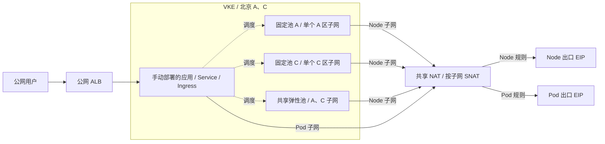

# 企业级容器集群自动化管理和弹性扩缩容

在火山引擎账号中创建多可用区 VKE 容器底座，包括独立 VPC、Node/Pod 子网、分用途公网出口、固定与弹性节点池、运维插件和公网 ALB。当前参数示例在北京 A/C 各配置一个固定节点，弹性容量由独立节点池提供。部署完成后，通过附带的 Kubernetes 示例配置 ALB Ingress 和应用，再验证公网访问、HPA 与节点扩缩容。

## 1. 业务背景

企业部署容器集群时，网络、出口、计算容量、负载均衡和运维组件需要配套配置，手工创建容易遗漏依赖或混用环境参数。

- **基线与峰值容量不同**：常态服务需要稳定节点，流量波峰需要独立扩展的临时容量。
- **网络边界需要明确**：Node 和 Pod 使用不同网段与公网 EIP，便于分别管理出口。
- **多可用区需要实际覆盖**：配置多个子网不等于节点已经跨区，需要检查实际落区和服务可用性。
- **Pod 与节点伸缩需要协作**：HPA 根据指标调整副本，cluster-autoscaler 根据不可调度 Pod 增加节点。

本方案将这些配置纳入 Terraform 管理，同时保留云基础设施与集群内应用的管理边界。

## 2. 方案概述

- **网络**：新建 VPC，每个 AZ 各一个 Node 子网和 Pod 子网，使用 `VpcCniShared`；一个公网 NAT 按来源子网配置 SNAT。
- **出口**：两枚独立的按流量计费 EIP，分别供 Node 和 Pod 使用；每个 AZ 各有对应 SNAT 规则。
- **计算**：每个 AZ 一个固定池，仅绑定本区 Node 子网并关闭自动伸缩；一个共享弹性池跨 AZ，默认初始 1、最小 0、最大 10。
- **组件**：安装 Prometheus、日志、NPD 和可选 autoscaler；只读核对平台预装 ALB controller、CCM、VPC-CNI；Apply 时幂等补齐 CoreDNS 和 metrics-server。
- **入站**：Terraform 创建公网 ALB；用户通过 ALBInstance、Service 和 Ingress 配置应用入口，监听器及后端由 Ingress controller 管理。



架构图以当前北京 A/C 示例为例。实线表示请求和网络路径，虚线表示 Pod 调度关系。应用、Service 和 Ingress 是使用者部署的集群内对象，不计入 Terraform 创建的云资源。

基础资源创建后，用户取得 Kubeconfig、绑定 ALBInstance、部署示例应用，并从公网访问应用。CPU 指标驱动 HPA 扩容；出现容量不足的 Pending Pod 时，autoscaler 扩展弹性节点池。固定池始终作为独立基线，不参与自动缩容。

CoreDNS 和 metrics-server 由模板内的 `terraform_data + local-exec + Python` 协调器创建，随后只读回查。组件已存在且版本、模式一致时保留；不自动升级，不单独删除，随集群回收。本模板不安装 scheduler-plugin，普通应用使用 Kubernetes 默认调度器。

## 3. IaC 设计

### 3.1 资源清单

按当前 `terraform.tfvars` 的两 AZ 配置，启用模板管理 autoscaler 时，创建 **21 个云资源和 1 个 Terraform 辅助对象，共 22 项新增**。可用区、固定容量及插件版本是必填输入，不是变量默认值。

| Terraform 资源 | 数量 | 用途 |
|---|---:|---|
| `volcenginecc_vpc_vpc` | 1 | 独立 VPC |
| `volcenginecc_vpc_subnet` | 4 | A/C 各一个 Node 子网和 Pod 子网 |
| `volcenginecc_natgateway_ngw` | 1 | 首个 Node 子网中的共享公网 NAT |
| `volcenginecc_vpc_eip` | 2 | Node 与 Pod 的独立出口 |
| `volcenginecc_natgateway_snatentry` | 4 | 每个 AZ 的两种子网分别关联对应 EIP |
| `volcenginecc_vke_cluster` | 1 | 托管 VKE 集群 |
| `volcenginecc_vke_node_pool` | 3 | 两个单 AZ 固定池与一个共享弹性池 |
| `volcenginecc_vke_addon` | 4 | Prometheus、日志、NPD、autoscaler |
| `volcenginecc_alb_load_balancer` | 1 | 公网应用入口 |
| `terraform_data` | 1 | 协调集群拥有的 CoreDNS 和 metrics-server |

组件模块的五个 Data Source 只读取三个平台组件和两个协调组件，根模块另有一个 `external` Data Source 执行只读预检，均不计入新建数量。Worker ECS、磁盘、网卡、隐式安全组、ALB 内嵌公网 EIP、控制面和集群内组件也不重复计入上述 21 个云资源，但仍有配额、费用和清理要求。

关闭 `manage_cluster_autoscaler` 后为 20 个云资源及 1 个辅助对象；三 AZ 配置增加两个子网、两条 SNAT 和一个固定池，为 26 个云资源及 1 个辅助对象。节点登录凭据、State 存储和运维连接由调用方提供；模板不创建 IAM Role、监控后端或日志后端。

### 3.2 工程结构

```text
.
├── modules/
│   ├── network/
│   │   ├── main.tf
│   │   ├── variables.tf
│   │   ├── outputs.tf
│   │   └── versions.tf
│   ├── cluster/
│   │   ├── main.tf
│   │   ├── variables.tf
│   │   ├── outputs.tf
│   │   └── versions.tf
│   ├── nodepools/
│   │   ├── main.tf
│   │   ├── variables.tf
│   │   ├── outputs.tf
│   │   └── versions.tf
│   ├── addons/
│   │   ├── main.tf
│   │   ├── variables.tf
│   │   ├── outputs.tf
│   │   └── versions.tf
│   └── alb/
│       ├── main.tf
│       ├── variables.tf
│       ├── outputs.tf
│       └── versions.tf
├── main.tf
├── locals.tf
├── variables.tf
├── outputs.tf
├── providers.tf
├── versions.tf
├── preflight.tf
├── terraform.tfvars
├── PREFLIGHT.md
├── scripts/
│   ├── preflight.py
│   ├── apply-checked.py
│   ├── reconcile-required-addons.py
│   ├── bootstrap-dns.py
│   ├── prepare-destroy.py
│   └── 验证公网出口.py
├── examples/
│   ├── app.yaml
│   ├── hpa.yaml
│   └── node-scale-test.yaml
├── .gitignore
├── LICENSE
├── README.md
└── README.zh-CN.md
```

工程树展示模板交付文件，不包含本地编辑器配置和内部验收记录。每个子模块包含 `main.tf`、`variables.tf`、`outputs.tf`、`versions.tf`。Provider 在根模块配置；模块之间通过输出建立网络、集群、节点池和插件的依赖。资源标签完全来自 `tags`，默认为 `{}`，模板不会自动添加 Name、Environment、Project、Owner、CostCenter。`project_name` 仍用于实际云项目归属。

### 3.3 核心代码示例

根模块 `main.tf` 将网络模块的按 AZ 子网映射和固定容量传入节点池模块：

```hcl
module "nodepools" {
  source                   = "./modules/nodepools"
  cluster_id               = module.cluster.id
  name_prefix              = var.name_prefix
  project_name             = var.project_name
  node_subnet_ids_by_zone   = module.network.node_subnet_ids_by_zone
  fixed_replicas_by_zone    = var.fixed_replicas_by_zone
  instance_types           = var.instance_types
  image_id                 = var.image_id
  node_login_method        = var.node_login_method
  ssh_key_pair_name         = var.ssh_key_pair_name
  node_password            = var.node_password
  system_volume_size       = var.system_volume_size
  system_volume_type       = var.system_volume_type
  elastic_initial_replicas = var.elastic_initial_replicas
  elastic_min_replicas     = var.elastic_min_replicas
  elastic_max_replicas     = var.elastic_max_replicas
  tags                     = local.common_tags
}
```

模块内固定池使用 `fixed_replicas_by_zone` 的 AZ 名称执行 `for_each`，每池只绑定对应的一个 Node 子网。AZ 键在 Plan 时已知，不依赖尚未创建的子网 ID；固定容量的 AZ 键必须与选定子网完全一致，每区至少一个节点。共享弹性池使用所有 Node 子网和 `ZoneBalance`，仅忽略 `auto_scaling.desired_replicas` 的外部变化，最小与最大容量仍由 Terraform 管理。

新环境的创建顺序为网络 → 集群 → 固定池与弹性池 → 可卸载插件 → Required 组件协调与回查；ALB 为独立网络分支。CoreDNS、metrics-server 由集群拥有，可卸载插件由 Terraform 管理；退出步骤见第 4.2.5 节。

## 4. 使用说明

本工程支持通过 InfraManager 在云上一键部署或下载模板在本地运行。推荐使用云上部署方式，无需自行准备 Terraform 运行环境，只需在平台填写参数即可完成资源创建和托管。

Terraform 创建基础设施及组件，应用、Ingress 和 HPA 则通过 Kubernetes 操作配置和验证。

### 4.1 云上部署

InfraManager 是火山引擎提供的 Terraform 托管工作台，更多产品介绍参见 [InfraManager 产品介绍](https://docs.volcengine.com/docs/infrastructure-management/product-introduction?lang=zh)。

#### 4.1.1 准备权限

部署前，请准备目标账号的服务、部署权限和节点登录凭据，并确认部署后的集群访问条件。可按以下顺序检查：

1. **开通服务并检查配额**

   在目标账号开通 VKE、ECS、VPC、NAT、EIP 和 ALB，确认目标项目、账号余额，以及各可用区的实例库存、磁盘、ENI、Pod IP 和节点配额。首次使用时，按服务控制台提示完成服务关联角色授权，涉及 VKE、ALB 和 NAT，包括 `ServiceRoleForNatGateway`。

2. **为部署身份授予云资源权限**

   部署身份需要 InfraManager 资源栈操作权限、CloudControl 权限，以及上述云资源的创建、读取、更新、删除、标签和关联权限。

   模板还会检查可用性并安装必要组件，因此需要 VKE `ListSupportedResourceTypes`、`ListSupportedAddons`、`ListSupportedImages`、`ListClusters`、`ListAddons`、`CreateAddon`，以及 ECS `DescribeAvailableResource` 权限。其中仅 `CreateAddon` 用于创建组件，其余接口用于读取和核对。

3. **准备节点登录凭据**

   选择密钥登录时，准备目标地域已有的 ECS SSH 密钥对，模板只填写密钥对名称，不提供私钥。选择密码登录时，按第 4.2.1 节配置节点密码。

4. **确认平台能够运行模板**

   平台执行环境需提供 `/bin/sh`、Python 3，并能访问 VKE/ECS HTTPS API。部署凭据由平台部署身份提供，且需供模板调用的子进程使用；临时凭据还需传递 `VOLCENGINE_SESSION_TOKEN`，不要将凭据写入模板参数文件。

   模板在 Plan 阶段通过 `hashicorp/external ~> 2.3` 运行 `scripts/preflight.py`，在 Apply 阶段运行 `scripts/reconcile-required-addons.py`；后者依赖同目录的 `scripts/preflight.py`，上传模板时须保留这些文件。地域版本确认步骤见第 4.2.2 节。

5. **准备集群连接和镜像访问**

   Kubernetes API 默认关闭公网访问，部署后使用 kubectl 时，需通过 VPN 或同 VPC 运维主机等私网路径连接。Worker 和 Pod 需能访问镜像仓库；示例使用公开 ECR 镜像，请确认目标网络能够拉取。

6. **为运维身份授予集群权限**

   部署后验证还需要目标集群的 Kubernetes RBAC 权限，包括查看节点、组件和指标，在测试命名空间管理应用、Pod、Service、Ingress、HPA，以及管理集群级 ALBInstance 和 IngressClass。云资源权限与集群权限分别授权，仅有某个命名空间的开发权限不足以完成全部验证。

#### 4.1.2 选择模板

打开 [InfraManager 控制台](https://console.volcengine.com/iac)，进入 **模板管理 > 公开模板**，搜索“企业级容器集群自动化管理和弹性扩缩容”。

公开模板需由平台发布后才能搜索到。使用本地修订版本时，通过自定义导入上传完整模板包，再选择导入的模板创建资源栈。

保留根 Terraform 文件、`modules/`、`scripts/` 和 `examples/` 的相对目录结构。仅上传 `.tf` 文件会缺少预检和组件协调脚本。发布包不包含内部验收记录、编辑器配置、`.env`、State、Plan、缓存、Kubeconfig 和本地部署输出；`terraform.tfvars` 只保留非敏感示例。当前工程没有 `.terraform.lock.hcl`，执行环境初始化后生成并保留自己的锁文件；ZIP 内使用 `/` 路径分隔符。

#### 4.1.3 创建资源栈

选择模板并点击 **创建资源栈**，根据实际需求填写资源栈信息和模板参数。创建并检查执行计划，确认变更符合预期后，点击 **执行部署**。

参数说明见第 4.2.1 节，完整配置示例见第 4.2.2 节。`node_login_method` 必须显式选择：密钥模式提供 `ssh_key_pair_name` 并设置 `node_password=null`；密码模式设置 `ssh_key_pair_name=null` 并通过平台敏感输入提供密码。当前示例的 `REPLACE_ME` 不能通过校验。为独立环境设置唯一 `name_prefix`，核对可用区、Node/Pod 网段与固定容量的 AZ 键一致，并填写 `kubernetes_version` 及有效确认记录。

默认保持 VKE 删除保护开启、ALB 删除保护关闭，并使用平台资源栈删除保护。当前两 AZ 示例的新环境预期为 22 项新增。若平台将 Plan 和 Apply 分开执行，应在 Apply 前以计划中的同一组生效参数复查可用性；库存查询不会预留容量。

查看部署事件中的组件协调日志，确认 CoreDNS 和 metrics-server 已保留或创建并达到 Running/Ok。Apply 成功后继续执行下面的验证，不能仅凭静态输出或资源创建成功判定应用可用。

#### 4.1.4 部署验证

在资源栈详情页查看部署状态为“成功”，再查看模板输出：

| 输出 | 用途 |
|---|---|
| `vpc_id`、`subnets`、`nat_gateway_id` | 核对 VPC、各 AZ 的 Node/Pod 子网与 NAT |
| `egress` | Node/Pod EIP 地址及按 AZ 的 SNAT 标识 |
| `cluster_id`、`cluster_status` | 集群标识和服务状态 |
| `api_server_endpoints` | API 地址，不含 Kubeconfig |
| `nodepools` | 按 AZ 索引的固定池及共享弹性池 ID/status |
| `addons` | 可卸载插件、平台组件和协调组件状态 |
| `alb_id`、`alb_dns_name` | ALB 标识和实例域名；实例域名用作业务域名 CNAME 目标 |
| `alb_instance_manifest` | 将 ALB 绑定到 Ingress controller 的清单 |

所有输出均未声明为敏感，但包含实际资源标识和网络地址，应妥善保存；输出不包含密码或 Kubeconfig。资源栈资源页中，当前两 AZ 示例应有第 3.1 节的 21 个云资源及 1 个辅助对象。

**1. 核对落区、网络和组件。** 在 VKE、ECS、VPC、NAT 和 ALB 控制台按输出定位资源。每个固定池只绑定一个本区 Node 子网；用 VKE 节点及 ECS 网卡详情核对实际 `ZoneId`、主网卡子网和 Pod 网卡子网。按 `subnets` 核对两区四个子网，并检查每条 Node/Pod SNAT 的来源子网及对应 EIP。节点池标识可能为 `cluster_id|node_pool_id`，在 VKE 控制台使用节点池 ID 部分定位。

VKE 的组件管理页应显示 prometheus-agent、log-collector、node-problem-detector，以及启用时的 cluster-autoscaler 为 Running/Ok；ALB controller、CCM、VPC-CNI、CoreDNS、metrics-server 也应健康。从 VKE 控制台取得短期 Kubeconfig，保存于受控目录。在能访问私网 API 的运维环境下载完整模板，进入模板根目录，准备 Python 3、kubectl 和 curl 后执行：

```bash
export KUBECONFIG="/secure/path/to/kubeconfig"
kubectl get nodes -L workload-pool,topology.kubernetes.io/zone
kubectl -n kube-system get pods
kubectl -n kube-system get service kube-dns
kubectl -n kube-system get endpoints kube-dns
kubectl get --raw /apis/metrics.k8s.io/v1beta1/nodes
kubectl top nodes
```

当前示例应有 A/C 各一个固定 Ready 节点及一个初始弹性节点，系统 Pod Ready，DNS Endpoints 非空，metrics API 返回节点指标。组件或节点异常时先查对应事件、镜像拉取、地址容量和服务状态；403 先检查集群 RBAC，连接超时先检查私网路径。

**2. 配置并验证公网应用入口。** 将资源栈输出 `alb_instance_manifest` 的 YAML 正文保存为运维环境中的 `/tmp/vke-alb-instance.yaml`。确认 `spec.instanceID` 是本栈 `alb_id`，`blockCascadeDeletion` 为 true，名称为 `vke-alb`，且集群内没有同名业务对象，然后执行：

```bash
kubectl apply --dry-run=server -f /tmp/vke-alb-instance.yaml
kubectl apply -f /tmp/vke-alb-instance.yaml
kubectl get albinstance vke-alb -o yaml
kubectl get ingressclass vke-alb -o yaml
kubectl apply -f examples/app.yaml
kubectl -n vke-demo rollout status deployment/web --timeout=300s
kubectl -n vke-demo get ingress,service,pods -o wide
kubectl -n vke-demo exec deployment/web -- nslookup kubernetes.default.svc.cluster.local
```

等待 controller 建立对应的 IngressClass；其参数应引用 `vke-alb`。若对象尚未出现，检查 ALBInstance 状态、控制器和权限，再继续。示例应用应有两个 Ready 副本，Service Endpoints 与 Ready Pod IP 集合一致。在 ALB 控制台核对 HTTP 80 监听器、路径 `/` 规则和实际后端组：

```bash
kubectl -n vke-demo get pods -l app=web -o wide
kubectl -n vke-demo get endpoints web -o yaml
kubectl -n vke-demo describe ingress web
```

在 ALB 实例详情取得各区入站公网 IP，在集群外逐一访问。将占位值替换为实际 IP，每个入口均应返回 HTTP 200 和 `Welcome to nginx!`，curl 使用 IP 自身作为 Host：

```bash
for ip in "<ALB-A-public-IP>" "<ALB-C-public-IP>"; do
  curl --noproxy '*' --fail --show-error --connect-timeout 5 --max-time 30 \
    -w '\nHTTP %{http_code}\n' "http://${ip}/"
done
```

三 AZ 时增加第三个入口。超时先查公网监听器、访问控制和后端健康；404 先查 IngressClass、Host 和路径匹配。`ScheduleAnyway` 不强制应用跨区，需核对 Pod 实际分布。

2025 年 8 月 1 日后新建 ALB 的 `volcenginealb.com` 实例域名禁止直接用于业务访问，参见 [ALB 域名变更公告](https://www.volcengine.com/docs/6406/1657696)。正式业务需准备自有域名，在 DNS 控制台添加指向 `alb_dns_name` 的 CNAME，按需将该域名填写到 Ingress 的 `spec.rules[].host`，再验证解析和访问；操作参见 [添加 CNAME 记录](https://www.volcengine.com/docs/6406/130777)。本示例仅配置 HTTP，HTTPS 还需证书及 HTTPS 监听器。

**3. 验证两种出口。** 应用示例创建 `vke-demo` 后，在上述运维环境运行 `scripts/验证公网出口.py`。从栈输出填写 Node/Pod EIP，并按实际可用区修改列表：

```bash
python3 scripts/验证公网出口.py \
  --namespace vke-demo --zones cn-beijing-a cn-beijing-c \
  --node-egress-ip "<egress.node.address>" \
  --pod-egress-ip "<egress.pod.address>"
```

脚本只依赖 Python 3 标准库和已配置的 kubectl，不使用 Terraform State 或云 AK/SK。每区在固定节点上顺序创建一个 hostNetwork Pod 和一个普通 Pod，分别请求 `https://checkip.amazonaws.com` 与 `https://api.ipify.org`。两个回显都应匹配对应 EIP，脚本同时打印节点、hostIP 和 podIP；再对照本区 Node/Pod CIDR 与网卡归属。hostNetwork Pod 共享 Node 地址，普通 Pod 使用 Pod 地址。

每个 Pod 默认等待 300 秒，两次 curl 各最多 30 秒。成功后删除该 Pod；重复运行生成新名称，不覆盖已有应用。全部匹配返回 0，运行或核对失败返回 1，参数错误返回 2。失败和 Ctrl+C 会保留当前 Pod 并打印名称，使用 `kubectl -n vke-demo describe pod <name>`、`kubectl -n vke-demo logs <name>` 排查后，用 `kubectl -n vke-demo delete pod <name>` 清理。超时先检查 DNS、TLS、回显站点和 Pod 事件，再查 SNAT；单个外部站点故障不能直接证明出口配置错误。

**4. 验证弹性节点。** 先记录两区固定节点名称、云实例 ID 和弹性池节点数，再对附带测试命名空间施加容量负载：

```bash
kubectl -n vke-demo apply -f examples/node-scale-test.yaml
kubectl -n vke-demo scale deployment/node-scale-test --replicas=40
kubectl -n vke-demo get pods -l app=node-scale-test -o wide
kubectl -n vke-demo get events --sort-by=.lastTimestamp
kubectl get nodes -L workload-pool,topology.kubernetes.io/zone
kubectl -n vke-demo rollout status deployment/node-scale-test --timeout=1200s
kubectl -n vke-demo delete deployment/node-scale-test --wait=true
kubectl get nodes -l workload-pool=elastic -w
```

每个负载 Pod 请求 1 CPU 且只能进入弹性池。按可分配容量调整副本数，确认 Pending 原因为 CPU 不足、弹性节点增加且 Ready、负载最终就绪，同时两区固定节点的数量与身份保持不变。若不扩容，先查 Pod 事件、autoscaler 状态、最大容量、规格库存及配额。

移除负载后观察弹性节点减少，按 Ctrl+C 结束观察。默认空闲与扩容后冷却均为 10 分钟，节点排水和删除还需时间；PDB、系统 Pod 和本地存储可能阻止继续缩容，不能保证回到最小值 0。回落后在 VKE/ECS 中核对被移除节点及其实例、网卡已回收。

**5. 验证 HPA（使用 HPA 时执行）。** 此项与节点容量验证独立，需要实际 CPU 指标：

```bash
kubectl apply -f examples/hpa.yaml
kubectl -n vke-demo get hpa web
kubectl -n vke-demo top pods -l app=web
```

HPA 使用 CPU 目标 60%、副本范围 2–30、缩容稳定窗口 300 秒。在独立测试环境，可创建 5 个负载 Pod，每个最多 20 个并发请求循环：

```bash
kubectl -n vke-demo create deployment hpa-load \
  --image=public.ecr.aws/docker/library/busybox:1.37 --replicas=5 \
  -- sh -c 'for n in $(seq 1 20); do while true; do wget -q -T 2 -O- http://web/ >/dev/null || true; done & done; wait'
kubectl -n vke-demo rollout status deployment/hpa-load --timeout=180s
kubectl -n vke-demo get hpa web -w
# 按 Ctrl+C 结束观察后停止负载：
kubectl -n vke-demo delete deployment/hpa-load --ignore-not-found --wait=true
kubectl -n vke-demo get deployment web
```

记录 CPU 指标与 Ready 副本增加，停止负载后确认实际副本及就绪数回到 2。按配额和成本控制压测规模；小规模 Nginx 请求不一定超过阈值。Prometheus 安装完成不能替代 metrics API 验证。

核对完成后删除负载、HPA 和本次应用，按第 4.2.5 节先清理 Ingress，再清理 ALBInstance，让 controller 回收关联对象；保留基础设施时也应清理这些测试对象。本节的落区、双出口、组件健康、弹性节点及公网 IP 步骤参考了远程部署的业务验证，但部署版本未与当前源码完整核对，不能作为整栈生命周期的验收结论。HPA、自定义域名、HTTPS 和实际节点登录需在目标环境另行验证。

### 4.2 本地部署

您也可以下载本工程模板在本地运行，需要按照下述步骤操作。

在模板根目录执行 Terraform；部署后 kubectl 的私网连接要求与云上相同。

#### 4.2.1 环境准备

**基础环境**：Terraform `>= 1.5.7, < 2.0.0`，Python 3 和 `/bin/sh`。Provider 约束为 `volcengine/volcenginecc ~> 0.0.74`（`>= 0.0.74, < 0.1.0`）和 `hashicorp/external ~> 2.3`（`>= 2.3.0, < 3.0.0`）。当前没有 `.terraform.lock.hcl`，首次 `terraform init` 会选择满足约束的版本并生成锁文件；保留该环境的锁文件以固定后续版本。执行机需访问 Provider 下载地址及 VKE/ECS HTTPS API。业务验证另需 kubectl、curl 和可访问集群 API 的网络。

**服务与配额**：按第 4.1.1 节，在控制台完成服务开通、项目权限、服务关联角色、密钥登录时的密钥对准备，以及实例库存、磁盘、ENI、地址容量和节点配额核对。本地身份同样需预检与组件协调权限；运维身份另需集群 RBAC。

**凭证注入**（推荐环境变量，不要写入代码或 `tfvars`）：

```bash
export VOLCENGINE_ACCESS_KEY="your_access_key"
export VOLCENGINE_SECRET_KEY="your_secret_key"
export VOLCENGINE_REGION="cn-beijing"
```

临时凭据另设置 `VOLCENGINE_SESSION_TOKEN`。Provider 使用显式配置的 `var.region`，`VOLCENGINE_REGION` 不会覆盖参数文件中的地域；预检也使用 Terraform 生效的地域。模板不生成 Kubeconfig。

**敏感业务变量**：`node_password` 为敏感字段，用于 Password 模式的 Worker 系统登录。原始密码需为 8–30 位，至少包含大写字母、小写字母、数字、特殊字符中的三类；特殊字符仅支持 `()~!@#$%^&*_+-=`。建议通过环境变量注入，不要写入 `terraform.tfvars`：

```bash
export TF_VAR_node_password="<your-strong-node-password>"
```

先移除参数文件中的 `node_password` 赋值，再注入环境变量；`terraform.tfvars` 或 `-var-file` 的同名赋值优先于 `TF_VAR_*`。Password 模式同时设置 `node_login_method="Password"`、`ssh_key_pair_name=null`。SshKeyPair 模式清除密码环境变量、设置 `node_password=null`，并提供已有密钥对名称，不传私钥。密码使用原文，模板自动 Base64 编码；Base64 不是加密，密码及编码值可能保存在 State、Plan 和 JSON 展示中，须保护这些文件和后端访问权限。

**重点参数**：默认值来自 `variables.tf`。当前 `terraform.tfvars` 是北京 A/C、每区一个固定节点、初始一个弹性节点、`ecs.g4i.4xlarge`、Kubernetes 1.32 确认记录及指定插件版本的示例，并选择 Password 模式。这些均不代表目标账号当前可用；文件还需显式补上必填 `kubernetes_version`，更新确认记录并移除密码占位赋值。第 4.2.2 节给出基于此文件的部署示例。

| 参数 | 默认值 / 入口 | 说明 |
|---|---|---|
| `region` | **必填，无默认值** | 目标地域，必须与可用区和版本确认对象一致 |
| `project_name` | `default` | 已有项目 |
| `name_prefix` | **必填，无默认值** | 2–36 位，小写字母开头，允许数字和连字符，同环境内唯一 |
| `tags` | `{}` | 仅添加用户明确配置的标签 |
| `vpc_cidr` | `10.0.0.0/16` | 新建私网 VPC |
| `zones` | **必填，无默认值** | 2–3 个不同 AZ；Node/Pod 网段需位于 VPC 内且互不重叠 |
| `service_cidr` | `172.22.0.0/22` | 与 VPC 及已有连接网络不重叠 |
| `kubernetes_version` | **必填，无默认值** | 使用 `1.xx` 格式，必须与版本确认对象一致 |
| `kubernetes_version_confirmation` | **必填，无默认值** | 包含 `region`、`version`、`resolved_version`、`verified_at_utc`，须与创建页一致，有效期 24 小时 |
| `instance_types` | **必填，无默认值** | 1–10 个不同的 VKE 规格，预检逐 AZ 确认当前库存 |
| `image_id` | `null` | **条件必填**：单规格使用 VKE 默认镜像；多规格需填写公共兼容镜像 |
| `node_login_method` | **必填，无默认值** | 固定池和弹性池统一使用 `SshKeyPair` 或 `Password` |
| `ssh_key_pair_name` | `null` | **条件必填**：密钥模式填写目标地域已有密钥对名称；密码模式须为 `null` |
| `node_password` | `null`（敏感） | **条件必填**：密码模式填写原始密码；密钥模式须为 `null` |
| `system_volume_size` / `system_volume_type` | `80` / `ESSD_PL0` | GiB，40–2048 整数；也支持 `ESSD_FlexPL` |
| `fixed_replicas_by_zone` | **必填，无默认值** | AZ 键必须与 `zones` 一致，每区 1–2000 整数 |
| `elastic_initial_replicas` / `elastic_min_replicas` / `elastic_max_replicas` | `1` / `0` / `10` | 整数且满足 `0 <= min <= initial <= max <= 2000` |
| `nat_spec` | `Small` | 也支持 Medium、Large、Extra_Large_1/2，需确认地域可用性 |
| `egress_bandwidth` | `10` | 两枚出口 EIP 各自的 Mbps 上限，1–200 整数 |
| `alb_bandwidth` | `10` | 入站 EIP 的创建期带宽，1–200 Mbps；变更可能替换 ALB |
| `vke_delete_protection_enabled` | `true` | 销毁前通过审查后的更新关闭 |
| `alb_delete_protection_enabled` | `false` | 默认配合平台栈保护；已开启保护的环境按迁移指南退出 |
| `api_server_public_access_enabled` | `false` | 默认私网 API；开启公网时另行安排管理访问控制 |
| `addon_versions` | **必填，无默认值** | Prometheus、日志、NPD、autoscaler 的版本映射 |
| `required_addons` | **必填，无默认值** | CoreDNS、metrics-server 的版本与部署方式；仅允许这两个组件 |
| `required_addons_reconcile_nonce` | `run-1` | 修复外部漂移后修改，触发重新协调 |
| `required_addons_timeout_seconds` | `1200` | 300–3600 秒整数，协调器总体上限 |
| `manage_cluster_autoscaler` | `true` | 是否创建并管理 autoscaler；对已受管环境改为 false 会计划删除该组件 |
| `scale_down_unneeded_minutes` | `10` | 空闲缩容等待，1–60 分钟整数 |

Node/Pod 子网均需满足地址容量要求。Service 网段与外部连接网络的重叠需要调用方核对。四个插件已有安装时先处理所有权，不能重复创建；若已有 autoscaler，应在受控迁移中导入其对应资源，或关闭模板管理并核对既有配置。

`required_addons` 必须恰好包含 `core-dns` 和 `metrics-server`：Managed 模式的 `deploy_node_type` 应省略或为 `null`，Unmanaged 模式必须填写 `Node` 或 `VirtualNode`，且通过目标地域兼容性预检。新环境关闭 autoscaler 管理时，需由调用方提供控制器才能自动扩容；不要把关闭开关当作保留已受管组件的方式。

#### 4.2.2 场景化部署示例

以下以新建北京 A/C 双 AZ 集群为例，每区一个固定节点，初始一个弹性节点。

1. **准备参数**

   使用 `terraform.tfvars` 中的网络、节点容量和插件配置，按第 4.2.1 节核对规格、版本及登录凭据。将 `name_prefix` 改为本次环境的唯一值，并补充或更新以下参数：

   ```hcl
   kubernetes_version = "1.32"
   kubernetes_version_confirmation = {
     region           = "cn-beijing"
     version          = "1.32"
     resolved_version = "<verified-full-Kubernetes-version>"
     verified_at_utc  = "<actual-ISO8601-verification-time-with-timezone>"
   }
   ```

   在目标地域 VKE 创建集群页面核对完整版本，将占位值替换为实际版本和带时区核对时间，确认记录有效期为 24 小时。当前示例使用 Password 模式，须删除 `node_password` 的占位赋值（`REPLACE_ME`），再按第 4.2.1 节注入密码。

2. **初始化与校验**

   在模板根目录执行：

   ```bash
   terraform init
   terraform fmt -check -recursive
   terraform validate
   ```

3. **检查计划并部署**

   ```bash
   terraform plan -input=false -out=deploy.tfplan
   terraform show deploy.tfplan
   # 确认资源及参数符合预期后执行：
   python3 scripts/apply-checked.py deploy.tfplan
   ```

   Plan 会检查规格库存、插件和镜像兼容性；复检脚本依赖同目录的 `scripts/preflight.py`，在 Apply 前再次核对可用性，失败时停止部署。库存检查不预留容量。

需要三 AZ 时，同步增加 `zones` 与 `fixed_replicas_by_zone` 条目，使用独立 Node/Pod 网段，并先确认该区服务和规格可用。

#### 4.2.3 部署预期结果

上述两 AZ 示例预期创建 **21 个云资源和 1 个 Terraform 辅助对象**，初始有三个 Ready Worker：两个固定节点、一个弹性节点。资源明细见第 3.1 节。

查看资源输出，并保存后续绑定 ALB 所需的清单：

```bash
terraform output
terraform output -raw alb_instance_manifest > /tmp/vke-alb-instance.yaml
```

输出含义见第 4.1.4 节。ALB 创建后，还需部署应用和 Ingress 才能提供业务访问；资源及流量按实际规格、时长和用量计费。

#### 4.2.4 部署后验证

从 VKE 控制台取得目标集群 Kubeconfig，在能连接私网 API 的运维环境中进入模板根目录。以下命令使用独立测试命名空间 `vke-demo`，执行前确认没有同名业务对象。

先查看集群并部署示例应用：

```bash
export KUBECONFIG="/secure/path/to/kubeconfig"
kubectl get nodes -L workload-pool,topology.kubernetes.io/zone
kubectl -n kube-system get pods
kubectl get --raw /apis/metrics.k8s.io/v1beta1/nodes
kubectl apply -f /tmp/vke-alb-instance.yaml
kubectl apply -f examples/app.yaml
kubectl -n vke-demo rollout status deployment/web --timeout=300s
kubectl -n vke-demo get endpoints web
kubectl -n vke-demo exec deployment/web -- nslookup kubernetes.default.svc.cluster.local
```

| 检查项 | 预期结果 | 异常优先检查 |
|---|---|---|
| 节点与组件 | 三个 Worker Ready，两个固定节点分别位于 A/C；VKE 组件管理页的四个指定 Addon 及支撑组件健康，指标接口可用 | Pod 事件、镜像拉取、组件状态 |
| 应用与 DNS | 两个应用副本 Ready，Service Endpoints 对应 Ready Pod，集群域名可解析 | 应用事件、CoreDNS |
| Node/Pod 出口 | 下方两区探针分别返回 `egress.node.address` 与 `egress.pod.address` | DNS、回显站点、SNAT 来源子网及 EIP |
| ALB 公网入口 | 两区公网 IP 均返回 HTTP 200 和 Nginx 页面，HTTP 80 后端对应 Ready Pod | ALBInstance、IngressClass、监听器及后端健康 |

**出口检查**：每区分别创建普通 Pod 和 hostNetwork Pod，输出中的 `pod` 应匹配 Pod EIP，`node` 应匹配 Node EIP。正常结束后探针自动删除：

```bash
for zone in cn-beijing-a cn-beijing-c; do
  for role in pod node; do
    host_network=false
    [ "$role" != node ] || host_network=true
    printf '%s %s\n' "$zone" "$role"
    kubectl -n vke-demo run "egress-${role}-${zone##*-}" \
      --image=public.ecr.aws/docker/library/nginx:1.28-alpine \
      --restart=Never --rm -i --pod-running-timeout=180s \
      --overrides="{\"spec\":{\"hostNetwork\":${host_network},\"dnsPolicy\":\"ClusterFirstWithHostNet\",\"nodeSelector\":{\"workload-pool\":\"fixed\",\"topology.kubernetes.io/zone\":\"${zone}\"}}}" \
      --command -- curl -fsS --connect-timeout 5 --max-time 30 https://checkip.amazonaws.com
  done
done
```

失败时查看探针事件和日志，并按名称删除遗留 Pod。三 AZ 配置需将第三个区加入循环。

**公网检查**：从 ALB 控制台取得各区公网 IP，在集群外逐个替换下方占位值执行。默认实例域名不能直接用于业务访问，自定义域名配置见第 4.1.4 节。

```bash
curl --noproxy '*' -fsS --connect-timeout 5 --max-time 30 \
  -w '\nHTTP %{http_code}\n' "http://<ALB-public-IP>/"
```

扩缩容和 HPA 属于按需验证，操作入口见第 4.1.4 节的第 4、5 项。基础自检完成后，按第 4.2.5 节清理测试对象；可保留基础设施继续使用。

#### 4.2.5 销毁资源

销毁前备份需要保留的业务数据，并使用原部署目录、地域、Workspace、State 和参数。

1. **清理应用入口**

   以下命令仅适用于本 README 的独立测试环境：

   ```bash
   kubectl -n vke-demo delete ingress web --ignore-not-found --wait=true
   kubectl delete albinstance vke-alb --ignore-not-found --wait=true
   kubectl delete -f examples/app.yaml --ignore-not-found
   ```

   `app.yaml` 会删除整个测试命名空间；其中有其他业务时，应逐项清理。确认控制器已回收 IngressClass、监听器、规则和后端组，再销毁基础设施。

2. **关闭删除保护并销毁**

   使用现有脚本检查并关闭目标 VKE/ALB 的删除保护，再审查删除计划。将地域替换为实际值：

   ```bash
   python3 scripts/prepare-destroy.py --root . --region cn-beijing
   # 核对目标资源及关闭保护动作后执行：
   python3 scripts/prepare-destroy.py --root . --region cn-beijing --apply
   terraform plan -destroy
   terraform destroy
   ```

   `scripts/prepare-destroy.py` 依赖同目录的 `scripts/preflight.py`、Python 3、Terraform 和云凭据，需具备目标 VKE/ALB 的读取与保护修改权限。默认只读，`--apply` 仅关闭保护；超时 600 秒，成功返回 0，失败返回 1。**已有 ALB 开启保护时，也按此流程处理，不通过普通 Apply 关闭保护**；准备完成后直接销毁，避免保护被重新开启。

   InfraManager 用户在控制台关闭 VKE、ALB 及资源栈的删除保护后，删除资源栈并选择删除云资源。

3. **核对清理结果**

   在控制台确认集群、Worker、网卡、网络、NAT/SNAT、EIP 和 ALB 相关资源已回收。集群组件随集群删除，已有 SSH 密钥对和 State 后端不在模板删除范围。销毁失败时保留 State，先核对云端任务和残留。

## 5. 总结

本模板提供按 AZ 隔离固定基线、独立弹性节点池、Node/Pod 双出口和 ALB 应用入口，并安装和核对所需运维组件。它交付容器基础设施，应用、Ingress、HPA、日志接入和业务数据管理仍由使用者配置；NPD 检测节点问题，不等于自动修复。

一个共享 NAT 位于首个 Node 子网，不提供跨 AZ NAT 故障切换；示例入口使用 HTTP，应用副本分布也需要实际核对。生产环境应按业务需求补充 TLS、备份、容量规划、网络策略和监控告警。Prometheus、日志采集器安装成功不代表数据已进入 VMP/TLS，本模板不创建这些后端。

服务规格、版本、计费和权限以目标地域控制台及官方文档为准。
