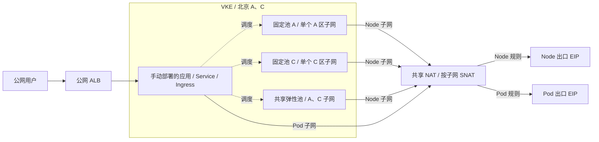

# 企业级容器集群自动化管理和弹性扩缩容

在火山引擎账号中创建多可用区 VKE 容器底座，包括独立 VPC、Node/Pod 子网、分用途公网出口、固定与弹性节点池、运维插件和公网 ALB。默认北京 A/C 各有一个固定节点，弹性容量由独立节点池提供。部署完成后，通过附带的 Kubernetes 示例配置 ALB Ingress 和应用，再验证公网访问、HPA 与节点扩缩容。

[English](README.md)

## 1. 业务背景

企业部署容器集群时，网络、出口、计算容量、负载均衡和运维组件需要配套配置，手工创建容易遗漏依赖或混用环境参数。

- **基线与峰值容量不同**：常态服务需要稳定节点，流量波峰需要独立扩展的临时容量。
- **网络边界需要明确**：Node 和 Pod 使用不同网段与公网 EIP，便于分别管理出口。
- **多可用区需要实际覆盖**：配置多个子网不等于节点已经跨区，需要检查实际落区和服务可用性。
- **Pod 与节点伸缩需要协作**：HPA 根据指标调整副本，cluster-autoscaler 根据不可调度 Pod 增加节点。

本方案将这些配置纳入 Terraform 管理，同时保留云基础设施与集群内应用的管理边界。

## 2. 方案概述

- **网络**：新建 VPC，每个 AZ 各一个 Node 子网和 Pod 子网，使用 `VpcCniShared`；一个公网 NAT 按来源子网配置 SNAT。
- **出口**：两枚独立的按流量计费 EIP，分别供 Node 和 Pod 使用；每个 AZ 各有对应 SNAT 规则。
- **计算**：每个 AZ 一个固定池，仅绑定本区 Node 子网并关闭自动伸缩；一个共享弹性池跨 AZ，默认初始 1、最小 0、最大 10。
- **组件**：安装 Prometheus、日志、NPD 和可选 autoscaler；只读核对平台预装 ALB controller、CCM、VPC-CNI；Apply 时幂等补齐 CoreDNS 和 metrics-server。
- **入站**：Terraform 创建公网 ALB；用户通过 ALBInstance、Service 和 Ingress 配置应用入口，监听器及后端由 Ingress controller 管理。



图中实线表示请求和网络路径，虚线表示 Pod 调度关系。应用、Service 和 Ingress 是使用者部署的集群内对象，不计入 Terraform 创建的云资源。

基础资源创建后，用户取得 Kubeconfig、绑定 ALBInstance、部署示例应用，并从公网访问应用。CPU 指标驱动 HPA 扩容；出现容量不足的 Pending Pod 时，autoscaler 扩展弹性节点池。固定池始终作为独立基线，不参与自动缩容。

CoreDNS 和 metrics-server 由模板内的 `terraform_data + local-exec + Python` 协调器创建，随后只读回查。组件已存在且版本、模式一致时保留；不自动升级，不单独删除，随集群回收。本模板不安装 scheduler-plugin，普通应用使用 Kubernetes 默认调度器。

## 3. IaC 设计

### 3.1 资源清单

默认两 AZ、管理 autoscaler 时，创建 **21 个云资源和 1 个 Terraform 辅助对象，共 22 项新增**。

| Terraform 资源 | 数量 | 用途 |
|---|---:|---|
| `volcenginecc_vpc_vpc` | 1 | 独立 VPC |
| `volcenginecc_vpc_subnet` | 4 | A/C 各一个 Node 子网和 Pod 子网 |
| `volcenginecc_natgateway_ngw` | 1 | 首个 Node 子网中的共享公网 NAT |
| `volcenginecc_vpc_eip` | 2 | Node 与 Pod 的独立出口 |
| `volcenginecc_natgateway_snatentry` | 4 | 每个 AZ 的两种子网分别关联对应 EIP |
| `volcenginecc_vke_cluster` | 1 | 托管 VKE 集群 |
| `volcenginecc_vke_node_pool` | 3 | 两个单 AZ 固定池与一个共享弹性池 |
| `volcenginecc_vke_addon` | 4 | Prometheus、日志、NPD、autoscaler |
| `volcenginecc_alb_load_balancer` | 1 | 公网应用入口 |
| `terraform_data` | 1 | 协调集群拥有的 CoreDNS 和 metrics-server |

五个 Data Source 只读取三个平台组件和两个协调组件，不计入新建数量。Worker ECS、磁盘、网卡、隐式安全组、ALB 内嵌公网 EIP、控制面和集群内组件也不重复计入上述 21 个云资源，但仍有配额、费用和清理要求。

关闭 `manage_cluster_autoscaler` 后为 20 个云资源及 1 个辅助对象；三 AZ 配置增加两个子网、两条 SNAT 和一个固定池，为 26 个云资源及 1 个辅助对象。已有 SSH 密钥对、State 存储和运维连接由调用方提供；模板不创建 IAM Role、监控后端或日志后端。

### 3.2 工程结构

```text
.
├── main.tf / locals.tf / variables.tf / outputs.tf
├── providers.tf / versions.tf / terraform.tfvars
├── .gitignore
├── modules/
│   ├── network/
│   ├── cluster/
│   ├── nodepools/
│   ├── addons/
│   └── alb/
├── scripts/
│   ├── preflight.py
│   ├── reconcile-required-addons.py
│   ├── bootstrap-dns.py
│   └── prepare-destroy.py
├── examples/
│   ├── app.yaml
│   ├── hpa.yaml
│   └── node-scale-test.yaml
└── README.md / README.zh-CN.md
```

每个子模块包含 `main.tf`、`variables.tf`、`outputs.tf`、`versions.tf`。Provider 在根模块配置；模块之间通过输出建立网络、集群、节点池和插件的依赖。主要资源统一使用 Name、Environment、Project、Owner、CostCenter 标签，附加标签不能覆盖这些基础字段。

### 3.3 核心代码示例

根模块 `main.tf` 将网络模块的按 AZ 子网映射和固定容量传入节点池模块：

```hcl
module "nodepools" {
  source                   = "./modules/nodepools"
  cluster_id               = module.cluster.id
  name_prefix              = var.name_prefix
  project_name             = var.project_name
  node_subnet_ids_by_zone   = module.network.node_subnet_ids_by_zone
  fixed_replicas_by_zone    = var.fixed_replicas_by_zone
  instance_types           = var.instance_types
  image_id                 = var.image_id
  ssh_key_pair_name         = var.ssh_key_pair_name
  system_volume_size       = var.system_volume_size
  system_volume_type       = var.system_volume_type
  elastic_initial_replicas = var.elastic_initial_replicas
  elastic_min_replicas     = var.elastic_min_replicas
  elastic_max_replicas     = var.elastic_max_replicas
  tags                     = local.common_tags
}
```

模块内固定池使用 `fixed_replicas_by_zone` 的 AZ 名称执行 `for_each`，每池只绑定对应的一个 Node 子网。AZ 键在 Plan 时已知，不依赖尚未创建的子网 ID；固定容量的 AZ 键必须与选定子网完全一致，每区至少一个节点。共享弹性池使用所有 Node 子网和 `ZoneBalance`，仅忽略 `auto_scaling.desired_replicas` 的外部变化，最小与最大容量仍由 Terraform 管理。

新环境的创建顺序为网络 → 集群 → 固定池与弹性池 → 可卸载插件 → Required 组件协调与回查；ALB 为独立网络分支。CoreDNS、metrics-server 由集群拥有，可卸载插件由 Terraform 管理；存量固定池迁移与退出步骤见第 4.2.4、4.2.5 节。

## 4. 使用说明

本工程支持通过 InfraManager 在云上创建和托管资源栈，也支持下载完整模板在本地执行 Terraform。推荐使用云上部署方式，在平台选择模板并填写参数，无需自行维护 Terraform 运行环境。两种入口使用相同的参数和云资源权限；平台执行器要求见第 4.1.1 节。

Terraform 创建基础设施及组件，应用、Ingress 和 HPA 则通过 Kubernetes 操作配置和验证。

### 4.1 云上部署

InfraManager 是火山引擎的 Terraform 托管工作台，参见 [InfraManager 产品介绍](https://docs.volcengine.com/docs/infrastructure-management/product-introduction?lang=zh)。

#### 4.1.1 准备权限和环境

在目标账号开通 VKE、ECS、VPC、NAT、EIP 和 ALB，确认项目、余额、各 AZ 的实例库存、磁盘、ENI、Pod IP 和节点配额。首次使用时，按服务控制台提示准备 VKE、ALB 及 NAT 的服务关联角色，包括 `ServiceRoleForNatGateway`。

执行身份需要 CloudControl，以及这些资源的创建、读取、更新、删除、标签和关联权限。组件协调器另外调用 VKE `ListClusters`、`ListSupportedAddons`、`ListAddons`、`CreateAddon`。准备目标地域已有的 ECS SSH 密钥对，只输入名称，不提供私钥。

**平台执行器需要 `/bin/sh`、Python 3、VKE HTTPS API 访问及可被子进程继承的部署凭据**。组件协调脚本在 Terraform Apply 的执行环境中运行；临时身份还需传递 `VOLCENGINE_SESSION_TOKEN`。凭据由平台部署身份提供，不写入模板参数文件。

默认关闭 Kubernetes API 公网访问，后续 kubectl 需通过 VPN、同 VPC 运维主机等私网路径连接。Worker 和 Pod 需要访问镜像仓库；示例采用公开 ECR 镜像，部署前确认目标网络可拉取。

#### 4.1.2 选择模板

打开 [InfraManager 控制台](https://console.volcengine.com/iac)，进入 **模板管理 > 公开模板**。模板公开发布后，搜索“企业级容器集群自动化管理和弹性扩缩容”。

公开模板需由平台发布后才能搜索到。使用本地修订版本时，通过自定义导入上传完整模板包，再选择导入的模板创建资源栈。

保留根 Terraform 文件、`modules/`、`scripts/` 和 `examples/` 的相对目录结构。仅上传 `.tf` 文件会缺少 Apply 时调用的组件协调脚本。发布包不包含 `docs/` 内部记录、`.terraform.lock.hcl`、`.env`、State、Plan、缓存、Kubeconfig 和本地部署输出；ZIP 内使用 `/` 路径分隔符。

#### 4.1.3 创建资源栈

选择模板并点击 **创建资源栈**，填写资源栈信息和第 4.2.1 节的模板参数。必须提供目标地域已有的 `ssh_key_pair_name`，并为独立环境设置唯一 `name_prefix`。核对 `zones`、两种子网和 `fixed_replicas_by_zone` 的 AZ 键一致。

默认保持 VKE 删除保护开启、ALB 删除保护关闭，并使用平台资源栈删除保护。创建执行计划，检查实际输入以及新增、更新、删除和替换动作。新环境默认为 22 项新增，再执行部署。

查看部署事件中的组件协调日志，确认 CoreDNS 和 metrics-server 已保留或创建并达到 Running/Ok。Apply 成功后继续执行下面的验证，不能仅凭静态输出或资源创建成功判定应用可用。

#### 4.1.4 部署验证

在资源栈详情页确认部署状态为“成功”，再从模板输出获得环境定位：

| 输出 | 用途 |
|---|---|
| `vpc_id`、`subnets`、`nat_gateway_id` | 核对 VPC、各 AZ 的 Node/Pod 子网与 NAT |
| `egress` | Node/Pod EIP 地址及按 AZ 的 SNAT 标识 |
| `cluster_id`、`cluster_status` | 集群标识和服务状态 |
| `api_server_endpoints` | API 地址，不含 Kubeconfig |
| `nodepools` | 按 AZ 索引的固定池及共享弹性池 ID/status |
| `addons` | 可卸载插件、平台组件和协调组件状态 |
| `alb_id`、`alb_dns_name` | ALB 标识及公网域名 |
| `alb_instance_manifest` | 将 ALB 绑定到 Ingress controller 的清单 |

在控制台核对资源关系与状态：固定池各绑定一个本区 Node 子网，Node/Pod SNAT 关联对应 EIP，四个指定 Addon 均安装且 Running/Ok。平台预装的 ALB controller、CCM、VPC-CNI，以及协调器管理的 CoreDNS、metrics-server 也应健康。节点池的 Provider 标识可能为 `cluster_id|node_pool_id`，在 VKE 控制台使用其中的节点池 ID 部分定位。

在 VKE 控制台取得短期 Kubeconfig，保存于受控目录，并在能访问私网 API 的运维环境执行：

```bash
export KUBECONFIG="/secure/path/to/kubeconfig"
kubectl get nodes -L workload-pool,topology.kubernetes.io/zone
kubectl -n kube-system get pods
kubectl -n kube-system get service kube-dns
kubectl -n kube-system get endpoints kube-dns
kubectl get --raw /apis/metrics.k8s.io/v1beta1/nodes
```

默认应有 A/C 各一个固定 Ready 节点，初始弹性节点为 1。再用 VKE 节点和 ECS 详情核对实际 `ZoneId` 及主网卡子网，不能只看配置或节点标签。

**配置公网应用入口。** 将 `alb_instance_manifest` 输出保存为运维环境中的临时 YAML，并执行：

```bash
kubectl apply --dry-run=server -f /tmp/enterprise-alb-instance.yaml
kubectl apply -f /tmp/enterprise-alb-instance.yaml
kubectl apply -f examples/app.yaml
kubectl -n vke-demo rollout status deployment/web --timeout=300s
kubectl -n vke-demo get ingress,service,pods -o wide
kubectl -n vke-demo exec deployment/web -- nslookup kubernetes.default.svc.cluster.local
```

在集群外访问 `http://<alb_dns_name>/`，预期 HTTP 200 和 Nginx 页面；核对 ALB HTTP 80 监听器、后端组、Ready Pod IP 和 Service Endpoints 一致。Pod 示例的跨 AZ 分布约束是 `ScheduleAnyway`，应检查实际分布，而非将其当作强制容灾保证。

**验证两种出口。** 从 `egress` 输出填写下面两枚地址，按实际 `zones` 修改循环列表。每区创建普通 Pod 和 hostNetwork Pod，均选择本区固定节点；Node 测试共享节点网络，Pod 测试使用独立 Pod 网段。

```bash
(
set -euo pipefail
NODE_EGRESS_IP="<egress.node.address>"
POD_EGRESS_IP="<egress.pod.address>"
for zone in cn-beijing-a cn-beijing-c; do
  for role in node pod; do
    host_network=false
    dns_policy=ClusterFirst
    expected="$POD_EGRESS_IP"
    if [ "$role" = node ]; then
      host_network=true
      dns_policy=ClusterFirstWithHostNet
      expected="$NODE_EGRESS_IP"
    fi
    probe=$(cat <<EOF | kubectl create -f - -o name
apiVersion: v1
kind: Pod
metadata:
  generateName: egress-${role}-${zone##*-}-
  namespace: vke-demo
spec:
  restartPolicy: Never
  hostNetwork: ${host_network}
  dnsPolicy: ${dns_policy}
  nodeSelector:
    workload-pool: fixed
    topology.kubernetes.io/zone: ${zone}
  containers:
    - name: check
      image: public.ecr.aws/docker/library/nginx:1.28-alpine
      command: ["curl", "-fsS", "--connect-timeout", "5", "--max-time", "30", "https://checkip.amazonaws.com"]
EOF
)
    kubectl -n vke-demo wait --for=jsonpath='{.status.phase}'=Succeeded "$probe" --timeout=180s
    observed=$(kubectl -n vke-demo logs "$probe" | tr -d '\r\n')
    printf '%s %s observed=%s expected=%s\n' "$zone" "$role" "$observed" "$expected"
    test "$observed" = "$expected"
    kubectl -n vke-demo get "$probe" -o wide
    kubectl -n vke-demo delete "$probe" --wait=true
  done
done
)
```

普通 Pod 应返回 Pod EIP，hostNetwork Pod 应返回 Node EIP；四路全部一致才通过。同时核对 Pod 的 `hostIP/podIP`、本区 Node/Pod CIDR，以及四条 SNAT 的子网和 EIP 成员。失败时保留测试 Pod，检查 describe/logs，处理后删除；公网回显服务不可达时先检查 DNS、TLS 和目的站点，不凭单次失败认定 SNAT 错误。

**验证弹性节点与 HPA。** 以下仅用于附带示例的测试命名空间：

```bash
kubectl -n vke-demo apply -f examples/node-scale-test.yaml
kubectl -n vke-demo scale deployment/node-scale-test --replicas=40
kubectl -n vke-demo get pods -l app=node-scale-test -o wide
kubectl get nodes -L workload-pool,topology.kubernetes.io/zone
kubectl -n vke-demo delete deployment/node-scale-test --wait=true
kubectl apply -f examples/hpa.yaml
kubectl -n vke-demo get hpa web
kubectl -n vke-demo top pods -l app=web
```

每个节点伸缩测试 Pod 请求 1 CPU 且只能进入弹性池。按可分配容量调整副本数，确认 Pending 原因为 CPU 不足、新节点 Ready、Pod 就绪，同时固定池各区容量保持不变。移除负载后观察节点减少；默认空闲与扩容后冷却均为 10 分钟，PDB、系统 Pod 和本地存储可能阻止进一步缩容。

HPA 使用 CPU 目标 60%、副本范围 2–30、缩容稳定窗口 300 秒。在独立测试环境，可创建 5 个负载 Pod，每个最多 20 个并发请求循环：

```bash
kubectl -n vke-demo create deployment hpa-load \
  --image=public.ecr.aws/docker/library/busybox:1.37 --replicas=5 \
  -- sh -c 'for n in $(seq 1 20); do while true; do wget -q -T 2 -O- http://web/ >/dev/null || true; done & done; wait'
kubectl -n vke-demo rollout status deployment/hpa-load --timeout=180s
kubectl -n vke-demo get hpa web -w
# 按 Ctrl+C 结束观察后停止负载：
kubectl -n vke-demo delete deployment/hpa-load --ignore-not-found --wait=true
kubectl -n vke-demo get deployment web
```

记录 CPU 指标与 Ready 副本增加，停止负载后确认实际副本及就绪数回到 2。按配额和成本控制压测规模；小规模 Nginx 请求不一定超过阈值。Prometheus 安装完成不能替代 metrics API 验证。

### 4.2 本地部署

下载完整模板，在模板根目录执行 Terraform；部署后 kubectl 的私网连接要求与云上相同。

#### 4.2.1 环境准备

**基础环境**：Terraform `>= 1.5.7, < 2.0.0`，Python 3 和 `/bin/sh`。Provider 约束为 `volcengine/volcenginecc ~> 0.0.74`，即 `>= 0.0.74, < 0.1.0`。发布包不附带 `.terraform.lock.hcl`，首次 `terraform init` 会选择满足约束的版本并在当前部署目录生成锁文件；保留该环境的锁文件以固定后续使用的版本。本地已完成的配置检查使用 0.0.74，其他版本需要另行验证。

**凭证注入**：

```bash
export VOLCENGINE_ACCESS_KEY="<access-key>"
export VOLCENGINE_SECRET_KEY="<secret-key>"
export TF_VAR_ssh_key_pair_name="<existing-regional-key-pair>"
# 使用临时凭据时，另设置 VOLCENGINE_SESSION_TOKEN。
```

AK/SK 与 Session Token 通过环境传递，不写入 HCL 或 `tfvars`。SSH 变量只传名称；模板不生成节点密码或 Kubeconfig。Provider 使用 `var.region`，单独设置 `VOLCENGINE_REGION` 不会覆盖文件中的地域。`terraform.tfvars` 的同名赋值优先于 `TF_VAR_*`，注入环境变量前检查是否存在文件赋值。

**重点参数**：默认值来自 `variables.tf`，`terraform.tfvars` 另外提供了插件版本示例。所有地域、规格和版本均需部署前确认。

| 参数 | 默认值 / 入口 | 说明 |
|---|---|---|
| `region` / `project_name` | `cn-beijing` / `default` | 目标地域和已有项目 |
| `name_prefix` | `enterprise-vke` | 2–36 位，小写字母开头，允许数字和连字符 |
| `environment` / `owner` / `cost_center` | `dev` / `platform` / `platform` | 环境、责任方和成本标签 |
| `tags` | `{}` | 附加标签，基础标签优先 |
| `vpc_cidr` | `10.0.0.0/16` | 新建私网 VPC |
| `zones` | 北京 A/C，两种子网各两份 | 2–3 个不同 AZ；Node/Pod 网段需位于 VPC 内且互不重叠 |
| `service_cidr` | `172.22.0.0/22` | 与 VPC 及已有连接网络不重叠 |
| `kubernetes_version` | `1.32` | 使用 `1.xx` 格式，核对实际支持版本 |
| `instance_types` | `["ecs.g4i.4xlarge"]` | 1–10 个各区可用且兼容 VKE 的规格 |
| `image_id` | `null` | 单规格使用 VKE 默认镜像；多规格需公共兼容镜像 |
| `ssh_key_pair_name` | 必填 | 目标地域已有密钥对名称 |
| `system_volume_size` / `system_volume_type` | `80` / `ESSD_PL0` | GiB，40–2048 整数；也支持 `ESSD_FlexPL` |
| `fixed_replicas_by_zone` | A=1、C=1 | AZ 键必须与 `zones` 一致，每区 1–2000 整数 |
| `elastic_initial_replicas` / `elastic_min_replicas` / `elastic_max_replicas` | `1` / `0` / `10` | 整数且满足 `0 <= min <= initial <= max <= 2000` |
| `nat_spec` | `Small` | 也支持 Medium、Large、Extra_Large_1/2，需确认地域可用性 |
| `egress_bandwidth` | `10` | 两枚出口 EIP 各自的 Mbps 上限，1–200 整数 |
| `alb_bandwidth` | `10` | 入站 EIP 的创建期带宽，1–200 Mbps；变更可能替换 ALB |
| `vke_delete_protection_enabled` | `true` | 销毁前通过审查后的更新关闭 |
| `alb_delete_protection_enabled` | `false` | 默认配合平台栈保护；已开启保护的环境按迁移指南退出 |
| `api_server_public_access_enabled` | `false` | 默认私网 API；开启公网时另行安排管理访问控制 |
| `addon_versions` | `{}`；文件提供四版本 | Prometheus、日志、NPD、autoscaler 的版本映射，推荐显式指定 |
| `required_addons` | CoreDNS 1.12.4、metrics-server v0.7.1-vke.6 | 默认均 Unmanaged/Node；仅允许这两个组件，需核对兼容性 |
| `required_addons_reconcile_nonce` | `run-1` | 修复外部漂移后修改，触发重新协调 |
| `required_addons_timeout_seconds` | `1200` | 300–3600 秒整数，协调器总体上限 |
| `manage_cluster_autoscaler` | `true` | 是否由模板管理；关闭后自动伸缩需已有控制器 |
| `scale_down_unneeded_minutes` | `10` | 空闲缩容等待，1–60 分钟整数 |

Node/Pod 子网均需满足地址容量要求。Service 网段与外部连接网络的重叠需要调用方核对。四个插件已有安装时先处理所有权，不能重复创建；若已有 autoscaler，应在受控迁移中导入其对应资源，或关闭模板管理并核对既有配置。

#### 4.2.2 场景化部署示例

**场景一：默认双 AZ 底座。** 确认 `terraform.tfvars` 中的北京 A/C、规格、插件版本和密钥对输入适用于目标账号，按以下步骤准备独立新环境。

在参数文件中填写下列基础配置，`vke-demo` 前缀应改为本次环境的唯一值；其余参数保留已确认的配置：

```hcl
region      = "cn-beijing"
name_prefix = "vke-demo"
zones = [
  { zone_id = "cn-beijing-a", node_cidr = "10.0.0.0/24", pod_cidr = "10.0.16.0/20" },
  { zone_id = "cn-beijing-c", node_cidr = "10.0.1.0/24", pod_cidr = "10.0.32.0/20" },
]
fixed_replicas_by_zone = {
  cn-beijing-a = 1
  cn-beijing-c = 1
}
elastic_initial_replicas = 1
elastic_min_replicas     = 0
elastic_max_replicas     = 10
# ssh_key_pair_name 通过平台参数或 TF_VAR_ssh_key_pair_name 提供。
```

运行预检查、初始化和部署：

```bash
python3 scripts/preflight.py \
  --region cn-beijing \
  --zones cn-beijing-a cn-beijing-c \
  --instance-types ecs.g4i.4xlarge > preflight.json
terraform init
terraform fmt -check -recursive
terraform validate
terraform plan -out=deploy.tfplan
terraform show deploy.tfplan
# 审查计划后执行：
terraform apply deploy.tfplan
```

预检查查询规格、镜像和九个组件，不创建资源，也不证明库存或业务就绪。首次 Plan 应为 22 项新增；Apply 补齐两项协调组件，无需另行运行 `bootstrap-dns.py`。

**场景二：验证仅固定基线。** 在另一个空 State 的独立测试环境中，使用场景一的网络和两区固定容量，仅替换前缀及初始弹性容量：

```hcl
name_prefix             = "vke-baseline-demo"
elastic_initial_replicas = 0
elastic_min_replicas     = 0
elastic_max_replicas     = 10
```

将前缀改为唯一值后，执行与场景一相同的 init、plan、show、apply 流程。新建数量仍为 22，但初始 Worker 只有两个固定节点。核对两区 Ready、DNS 和出口；该场景只验证初始固定基线，启用的 autoscaler 仍可在后续负载下增加弹性节点。

两种场景均面向独立新环境。已有弹性池忽略 live desired count 的变化，修改 `elastic_initial_replicas` 不会把运行中的节点数自动重置为 0，也不能用于替代缩容操作或存量迁移。

三 AZ 扩展需同步增加 `zones` 条目、独立 Node/Pod CIDR 和 `fixed_replicas_by_zone` 条目，每区至少一个节点。管理 autoscaler 时为 27 项新增；第三个 AZ 必须先确认服务和规格可用。

#### 4.2.3 部署预期结果

```bash
terraform output
terraform output -raw cluster_id
terraform output -json nodepools
terraform output -json egress
terraform output -raw alb_instance_manifest > /tmp/enterprise-alb-instance.yaml
```

默认应创建三个节点池，固定池输出按 AZ 索引，例如 `nodepools.fixed["cn-beijing-a"].id`。两种初始容量场景均为 21 个云资源及 1 个辅助对象；关闭模板管理 autoscaler 时少 1 个云资源。ALB 实例创建成功不等于已有监听器或可用应用；其他输出的含义及预期状态见第 4.1.4 节。

Worker ECS、系统盘、VKE 控制面、NAT、EIP、ALB 和公网流量产生对应费用；运行中的弹性节点也会计费。资源数量不等于账单项目数量，费用以规格、使用时长和实际用量为准。保护 State、Plan 和输出中的真实资源标识，不提交凭据或运行产物。

#### 4.2.4 部署后验证和更新

用本地输出获得资源标识和 ALBInstance 清单，执行第 4.1.4 节的控制台关系核对、私网 kubectl、DNS、公网入口、四路出口和伸缩验证。

每个稳定点连续两次检查 Plan：

```bash
for n in 1 2; do
  rc=0
  terraform plan -input=false -detailed-exitcode || rc=$?
  printf 'plan-%s exit=%s\n' "$n" "$rc"
  if [ "$rc" -ne 0 ]; then break; fi
done
```

两次均应为 0；2 表示存在计划变更，1 表示错误，先检查原因。参数更新后也要使用同一环境和最新参数执行检查。

可在测试环境将 `egress_bandwidth` 从 10 改为 11，审查只原地更新两枚出口 EIP，Apply 后回读相同 ID 和实际带宽，再执行两次 Plan；随后回滚 10 并重复核对。云上使用资源栈参数更新，本地修改受控参数文件后重新生成计划。

固定池从旧单对象变成按 AZ 的多个实例，旧 `fixed_replicas` 参数需改为映射，旧 `.fixed.id` 输出读取方式也需调整。存量池不能直接套用新配置：先设计过渡配置，创建新池、确认 Ready、排水迁移，再删除旧池。仅改变 nonce 可重复协调同版本缺失组件，不代表支持自动升级现有组件。

#### 4.2.5 销毁资源

先备份需要保留的业务数据并清理自建应用、Ingress、ALBInstance，让 controller 回收监听器、后端组和规则。下面的 Kubernetes 删除命令仅适用于附带示例的测试环境：

```bash
kubectl delete -f examples/hpa.yaml --ignore-not-found
kubectl -n vke-demo delete -f examples/node-scale-test.yaml --ignore-not-found
kubectl delete -f examples/app.yaml --ignore-not-found
kubectl delete albinstance enterprise-alb --ignore-not-found
```

`app.yaml` 包含测试命名空间；如果其中已有其他业务，应改为逐项清理本次创建的对象。确认控制器清理完成、ALB 仍由 Terraform 管理，再处理基础设施。

对创建时 ALB 保护为 false 的新环境：

```bash
terraform plan -var='vke_delete_protection_enabled=false' -out=exit.tfplan
terraform show exit.tfplan
# 确认只有预期原地更新、没有非预期替换后：
terraform apply exit.tfplan
terraform plan -destroy -var='vke_delete_protection_enabled=false'
terraform destroy -var='vke_delete_protection_enabled=false'
```

保持原地域、Workspace、State 和其他输入不变。InfraManager 用户先更新 VKE 保护参数为 false，再关闭平台栈删除保护并选择删除云资源，无需下载本地 State。

已有 ALB 云端保护为 true 的环境，应保持原有输入，不要直接应用新的默认值。本地先使用 `python3 scripts/prepare-destroy.py --region cn-beijing` 只读检查，将地域替换为实际值；确认对象归属和关闭保护动作后追加 `--apply`。脚本按原资源 ID 关闭保护，之后直接执行 Destroy，中间不要再普通 Apply。云上可在相应服务控制台确认保护已关闭后删除目标资源栈。任何非预期替换都先停止；失败时保留 State 并核对云端任务和残留，不先移除 State。

CoreDNS、metrics-server 及平台组件随集群回收，不单独调用 DeleteAddon。完成后按资源 ID 和本轮 VPC 核对集群、节点池、Worker ECS、子网、NAT、SNAT、四枚 EIP（两出口、两 ALB 入站）及 ALB 子资源。已有 SSH 密钥对和 State 后端不在模板删除范围；短期 Kubeconfig 和临时测试文件另行撤销或清理。

## 5. 总结

本模板提供按 AZ 隔离固定基线、独立弹性节点池、Node/Pod 双出口和 ALB 应用入口，并安装和核对所需运维组件。它交付容器基础设施，应用、Ingress、HPA、日志接入和业务数据管理仍由使用者配置；NPD 检测节点问题，不等于自动修复。

当前按 AZ 拆分固定池的版本完成 Terraform 1.5.7 的格式、配置及十个本地计划场景检查，**尚未完成新结构的云端生命周期验收**；此前单固定池版本的实测不能直接作为新结构证据。InfraManager 完整生命周期、委托身份与 State 隔离也需在目标环境验证。

一个共享 NAT 位于首个 Node 子网，不提供跨 AZ NAT 故障切换；示例入口使用 HTTP，应用副本分布也需要实际核对。生产环境应按业务需求补充 TLS、备份、容量规划、网络策略和监控告警。Prometheus、日志采集器安装成功不代表数据已进入 VMP/TLS，本模板不创建这些后端。

服务规格、版本、计费和权限以目标地域控制台及官方文档为准。组件管理、存量迁移和退出说明均保留在本 README，发布包不包含内部整改与验收记录。
